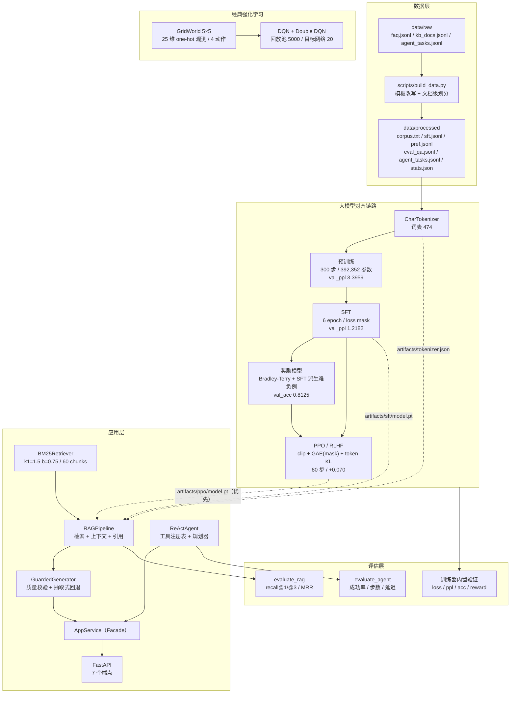
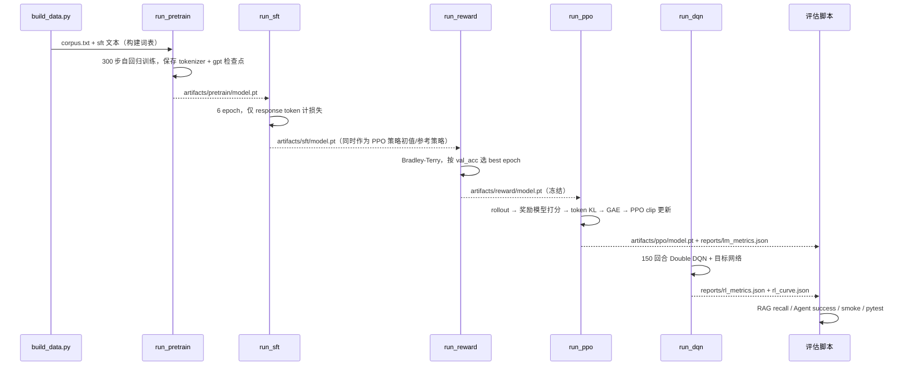

# 技术报告：MiniLLM Studio —— 轻量级 RLHF + RAG + Agent 全链路实践

> **作品定位**：面向「强化学习 / 大模型 / 深度学习算法工程师」岗位的可运行作品。
> **一句话概述**：在纯 CPU、无网络、无第三方模型依赖的约束下，从零实现
> TinyGPT 预训练 → SFT → Bradley-Terry 奖励模型 → PPO/RLHF 的对齐链路，
> 并配套 GridWorld + DQN 经典强化学习、BM25 + RAG 检索增强、ReAct Agent 与 FastAPI 服务，
> 所有指标由 `reports/*.json` 实测落盘。
>
> **版本**：`minillm-studio 0.1.0` ｜ **文档日期**：2026-11-01
> **代码基线**：仓库根目录 `minillm/`、`scripts/`、`configs/`
> **配套文档**：`README.md`（项目定位 / 快速开始 / API）、`docs/技术参考说明.md`（公式与代码映射）、
> `docs/设计流程思考.md`（选型 ADR 与复盘）
> **指标唯一来源**：`reports/lm_metrics.json`、`reports/rl_metrics.json`、`reports/rl_curve.json`、`reports/app_metrics.json`、`reports/ppo_samples.json`

---

## 摘要

本项目在**单机 CPU** 上完成了一条完整的「语言模型对齐 + 强化学习 + 检索 + Agent + 服务」链路，
所有模型从零训练，模型规模 **392,352 参数**，语料 **12,483 字符**，
五个训练阶段（预训练/SFT/奖励模型/PPO/DQN）总耗时约 **44.8 秒**（其中 LLM 四阶段约 42.7 秒）。

主要结果（均为实测，见 §5）：

* 预训练 300 步后验证集 **val_loss = 1.22256，val_ppl = 3.39587**；
* SFT 6 个 epoch 后验证集 **val_loss = 0.19737，val_ppl = 1.21819**；
* 奖励模型（引入 120 条 SFT 派生难负例后）在 16 条验证偏好对上
  **val_acc = 0.8125（95% Wilson CI 约 0.57–0.93），val_margin = 2.31742**；
* PPO 80 步后评估集平均奖励 **由 2.09344 提升到 2.16345（+0.07001）**，平均 KL 仅 0.008476
  （策略贴近 SFT），`best_step = 80`、`mean_reward_final = 2.16345`；
  **提升幅度小且伴随数字/日期幻觉**，本文如实记录（§6.2、§7）；
* RAG 检索：简单集 30 条查询 **recall@1 = recall@3 = 1.0、MRR = 1.0**（平均延迟 0.153 ms）；
  人工构造的语义改写难例集 10 条 **recall@1 = 0.7000、recall@3 = 0.9000、MRR = 0.8000** ——
  难例集暴露了纯词法 BM25 的语义泛化短板（§6.3）；生成侧另有「质量守卫 + 抽取式回退」（§5.5）；
* ReAct Agent 6 条评估任务：**成功率 1.0**，平均 2.0 步（1 次工具调用 + 1 次 final），平均延迟 **0.385 ms**；
* DQN 150 回合后终评 **成功率 1.0**，greedy 平均回报 **0.93**、平均 **8 步**到达终点。

结论：**工程链路与可复现性达标；模型效果受规模/数据限制明显**。
本报告把「哪里有效、哪里无效、为什么」写清楚，而不是只展示好看的数字。

---

## 1. 背景与目标

### 1.1 岗位视角：这个作品要证明什么

目标岗位要求的能力可以归为 5 类，本项目逐一给出可验证的证据：

| 能力项 | 岗位关注点 | 本项目证据 |
| --- | --- | --- |
| 大模型训练 | 预训练、SFT、LoRA、RLHF 全流程 | 四阶段训练器 + 统一检查点/指标契约 + 实测 PPL/奖励/KL |
| 强化学习 | DQN/PPO、值函数、策略梯度、稳定性 | GridWorld + Double DQN；PPO（clip + GAE + token 级 KL） |
| 检索与 Agent | RAG、BM25、工具调用、多步推理 | BM25 检索 + 引用溯源；ReAct Agent + 4 个工具 + 双规划器 |
| 工程能力 | Python 工程、API、测试、CI | 分层包结构、FastAPI 7 端点、pytest 分层、GitHub Actions |
| 实验素养 | 指标设计、误差分析、可复现 | 指标落盘、失败案例分析、种子/配置/产物约定、一键验收 |

### 1.2 业务视角：为什么做「校园助手」这个场景

数据是自造的**校园 FAQ 知识库**（食堂、图书馆、宿舍、奖助学金、教务、网络、就业、医疗等）。
选择这个场景的原因：

1. **数据可自造且可控**：不依赖任何公开数据集下载；
2. **问题域封闭**：FAQ 式问答适合小模型复述与检索增强，能观察到可解释的现象；
3. **贴近真实 RAG/Agent 落地形态**：「知识检索 + 工具计算 + 引用溯源」是校园助手/客服助手的典型结构；
4. **便于构造评估集**：每个问题有明确 gold 文档和答案关键词，指标可自动计算。

### 1.3 目标与非目标

**目标**

* 跑通并能量化：预训练 → SFT → 奖励模型 → PPO；GridWorld → DQN；检索 → RAG → Agent → API。
* 在 CPU 上**分钟级**复现全链路，指标可核查、产物可追溯。
* 体现工程判断：降级策略、契约先行、测试分层、可复现性。

**非目标**

* 不追求通用对话能力或 SOTA 指标（39 万参数 + 1.2 万字语料不具备这个条件）；
* 不引入 GPU、分布式、向量数据库、外部预训练权重（违反零网络依赖约束）；
* 不把「演示级」能力包装成「工业级」能力——本文会逐项标注。

---

## 2. 问题定义

### 2.1 总体问题

给定一个校园知识库 $\mathcal{D}$（10 篇文档、50 条 FAQ）、一批用户问题 $\mathcal{Q}$ 与任务 $\mathcal{T}$，
构建一个系统，使其能够：

1. **说知识**：对 FAQ 类问题给出有依据的回答，并可溯源到文档；
2. **会算数/换算**：对计算、单位换算、文本统计类任务调用确定性工具；
3. **能对齐**：用偏好数据让语言模型的回答更符合「问什么答什么」；
4. **能验证**：对上述能力给出可复现的量化指标。

### 2.2 四个子问题

**(1) 语言建模（预训练）**
在字符级语料上学习自回归分布 $p_\theta(x_t\mid x_{<t})$，目标是最小化交叉熵：

$$
\min_\theta\ \mathcal{L}_{\mathrm{LM}}(\theta)=-\frac{1}{T}\sum_{t=1}^{T}\log p_\theta(x_t\mid x_{<t})
$$

**(2) 指令微调（SFT）**
在 `prompt → response` 数据上只对 response 计损失（prompt 与 padding 位置为 `-100`）：

$$
\min_\theta\ \mathcal{L}_{\mathrm{SFT}}(\theta)=-\frac{1}{|\mathcal{R}|}\sum_{(x,y)\in\mathcal{D}_{\mathrm{sft}}}\sum_{t\in\mathcal{R}(y)}\log p_\theta(y_t\mid x,y_{<t})
$$

**(3) 偏好对齐（奖励模型 + PPO）**
先用 Bradley-Terry 学奖励 $r_\phi$，再用 PPO 优化策略 $\pi_\theta$：

$$
\max_\theta\ \mathbb{E}_{x\sim\mathcal{D},\,y\sim\pi_\theta(\cdot\mid x)}\Big[r_\phi(x,y)-\beta_{\mathrm{KL}}\sum_t \big(\log\pi_\theta-\log\pi_{\mathrm{ref}}\big)\Big]
$$

**(4) 经典 RL（DQN）**
在确定性 GridWorld 上学习动作价值 $Q(s,a)$，最大化折扣回报：

$$
\max_\theta\ \mathbb{E}\Big[\sum_{t=0}^{T}\gamma^t r_t\Big],\qquad
Q_\theta(s,a)\leftarrow r+\gamma(1-d)\cdot Q_{\bar\theta}\big(s',\arg\max_{a'}Q_\theta(s',a')\big)
$$

### 2.3 评估指标定义

| 任务 | 指标 | 定义 | 来源 |
| --- | --- | --- | --- |
| 语言建模 | val_loss / val_ppl | 验证块平均交叉熵 / 其指数 | `reports/lm_metrics.json` |
| 奖励模型 | val_acc / val_margin | 验证偏好对中 $r_c>r_r$ 的比例 / 平均 $r_c-r_r$ | 同上 |
| PPO | mean_reward_before/after、mean_kl、mean_entropy | 固定 8 条 prompt 上 greedy 生成后奖励模型均分；KL 为逐 token 均值；熵为动作分布熵均值 | 同上 |
| RAG | recall@1、recall@3、MRR | 按父文档 `doc_id` 判召回；MRR 取首个命中的 rank 倒数 | `reports/app_metrics.json` |
| Agent | success_rate、avg_steps | 答案含任一 expected_keyword 且实际工具集合覆盖 expected_tools | 同上 |
| DQN | final_success_rate、avg_return | 终评 20 回合 greedy 的成功率与平均回报 | `reports/rl_metrics.json`、`rl_curve.json` |

---

## 3. 总体方案

### 3.1 系统架构



### 3.2 五个能力块与代码落点

| 能力块 | 输入 | 核心实现 | 输出 |
| --- | --- | --- | --- |
| 预训练 | `corpus.txt` | `minillm/train/pretrain.py` → `run_pretrain` | `artifacts/pretrain/model.pt`、`artifacts/tokenizer.json` |
| SFT | `sft.jsonl` + 预训练检查点 | `minillm/train/sft.py` → `run_sft`（可选 LoRA） | `artifacts/sft/model.pt` |
| 奖励模型 | `pref.jsonl` + SFT 检查点 | `minillm/train/reward.py` → `run_reward`（+ `sft.jsonl` 派生难负例） | `artifacts/reward/model.pt` |
| PPO/RLHF | SFT + 奖励模型 + prompt | `minillm/train/ppo.py` → `run_ppo` | `artifacts/ppo/model.pt`、`reports/ppo_samples.json`（含 SFT 基线样本） |
| DQN | GridWorld | `minillm/rl/train.py` → `run_dqn` | `artifacts/rl/dqn.pt`、`reports/rl_*.json` |
| RAG | `faq.jsonl` + `kb_docs.jsonl` | `minillm/rag/{docs,retriever,pipeline}.py` | 带引用的答案 |
| 生成质量守卫 | 模型输出 + 检索上下文 | `minillm/rag/pipeline.py` → `GuardedGenerator` / `validate_generated_answer` | `source="model"` 或 `"extractive_fallback"` |
| Agent | 自然语言任务 | `minillm/agent/{tools,planner,react}.py` | `AgentTrace`（thought/action/observation） |
| API | HTTP 请求 | `minillm/serving/{app,service,schemas}.py` | JSON 响应与统一错误体 |

### 3.3 训练流程（阶段依赖）



### 3.4 设计决策摘要

| 决策 | 选择 | 核心理由 | 代价 |
| --- | --- | --- | --- |
| 模型来源 | 自研 TinyGPT（392,352 参数） | 零网络依赖，可展示完整训练链路 | 效果上限低 |
| 分词 | 字符级（词表 474） | 无需训练子词模型，中文无歧义 | 序列变长、语义密度低 |
| 检索 | BM25（纯 Python） | 60 chunk 规模够用、零依赖、可解释 | 无语义泛化能力 |
| 规划 | 规则规划器默认，LLM 可选 | 小模型规划不可靠，规则可测可解释 | 意图覆盖有限 |
| 架构 | 单仓分层 | 单人可维护，避免微服务联调成本 | 依赖进程内边界 |
| 无模型时 | 抽取式回退（标注 source） | 保证服务可演示、不欺骗调用方 | 答案不保证通顺 |

---

## 4. 实验设置

### 4.1 运行环境

| 项 | 值 |
| --- | --- |
| 操作系统 | Windows（本地开发）/ Ubuntu（CI） |
| Python | 3.13.15（本地）；CI 使用 3.11 |
| 深度学习框架 | torch 2.15.0+cpu |
| 数值/服务 | numpy 2.5.4、fastapi 0.162.0、pydantic 2.14.1 |
| 设备 | **纯 CPU**，无 GPU |
| 网络 | 全程不联网（不下载模型/数据集/embedding） |

### 4.2 数据规模

数据由 `scripts/build_data.py` 从 `data/raw` 生成，统计见 `data/processed/stats.json`：

| 数据项 | 数量 | 文件 | 用途 |
| --- | --- | --- | --- |
| 知识库文档 | 10（train 8 / eval 2） | `data/raw/kb_docs.jsonl` | RAG 检索语料（一篇一个 chunk） |
| FAQ | 50（train 40 / eval 10） | `data/raw/faq.jsonl` | SFT / 偏好 / 检索 / 评估的源头 |
| 预训练语料 | 12,483 字符 | `corpus.txt` | 仅 train 划分，多模板重复 |
| SFT 样本 | 120（40 FAQ × 3 问法） | `sft.jsonl` | 指令微调 |
| 偏好样本 | 80（40 FAQ × 2 问法） | `pref.jsonl` | 奖励模型（chosen=正确答，rejected=其他文档答案） |
| RAG 评估查询 | 30（10 eval FAQ × 3 问法） | `eval_qa.jsonl` | recall@1/@3、MRR |
| Agent 评估任务 | 6 | `agent_tasks.jsonl` | 成功率、平均步数 |
| 奖励模型派生偏好对（trainer 内构造） | 120 | `sft.jsonl` 派生 | 「正确回答 vs 随机另一条回答」难负例；**不改 `data/processed`，验证集仍只用 `pref.jsonl` 的 val 划分** |
| 字符表 | 465 个不重复非空白字符 | `stats.json → vocab_hint` | 实际词表 474（含 4 特殊 token 与 SFT 额外字符） |

### 4.3 模型结构与参数量

TinyGPT 为 decoder-only、pre-LN 结构（`minillm/models/tiny_gpt.py`）：

| 超参 | 默认值 | 说明 |
| --- | --- | --- |
| `n_layer` | 3 | Transformer Block 层数 |
| `n_head` / `n_embd` | 4 / 96 | 4 头 × 24 维 |
| `block_size` | 128 | 上下文长度 |
| `vocab_size` | 474 | 由 tokenizer 决定 |
| `dropout` | 0.1 | 注意力/残差/MLP/embedding 共用 |
| `tie_weights` | true | 输出头与 token embedding 共享 |
| `init_std` | 0.02 | 权重正态初始化标准差 |

参数量分解（`TinyGPT.num_parameters()` 实测 **392,352**）：

| 模块 | 参数量 |
| --- | --- |
| token embedding（`wte`，与 `lm_head` 共享） | 474 × 96 = 45,504 |
| 位置 embedding（`wpe`） | 128 × 96 = 12,288 |
| 3 × Transformer Block | 3 × 110,976 = 332,928 |
| 最终 LayerNorm | 192 |
| **合计** | **392,352** |

其它模型的参数量：

| 模型 | 参数量 | 说明 |
| --- | --- | --- |
| 奖励模型 `RewardModel` | 392,449 | 共享 TinyGPT backbone + 96 维奖励头（权重 96 + 偏置 1） |
| PPO 价值网络 `ValueModel` | 392,449 | 共享 backbone + 96 维价值头（权重 96 + 偏置 1） |
| LoRA（r=8，默认关闭） | 36,864 可训练 | 冻结主干后仅训练低秩旁路 |
| DQN `QNetwork` | 6,084 | 25 → 64 → 64 → 4 |

### 4.4 训练超参

| 阶段 | 关键超参 | 值 |
| --- | --- | --- |
| 预训练 | batch / lr / max_steps / warmup / eval_interval / grad_clip / val_ratio / seed | 16 / 3e-3 / 300 / 20 / 50 / 1.0 / 0.1 / 42 |
| SFT | epochs / batch / lr / val_ratio / use_lora / seed | 6 / 8 / 1e-3 / 0.1 / false / 0 |
| 奖励模型 | epochs / batch / lr / val_ratio / margin / seed | 6 / 8 / 1e-3 / 0.2 / 0.0 / 0（trainer 内另加 120 条 SFT 派生负例） |
| PPO | max_steps / batch_prompts / horizon / lr / value_lr / clip / kl_coef / gamma / lam / ppo_epochs / minibatch / entropy_coef / temperature | 80 / 8 / 48 / 2e-5 / 5e-4 / 0.2 / 0.2 / 1.0 / 0.95 / 2 / 8 / 0.01 / 0.8 |
| DQN | episodes / max_steps / gamma / lr / buffer / batch / learning_starts / target_update / ε / eval_interval / hidden | 150 / 50 / 0.95 / 1e-3 / 5000 / 32 / 100 / 20 / 1.0→0.05（×0.985）/ 25 / 64 |
| RAG | top_k / k1 / b / max_context_chars / snippet_chars / guard_model_output | 3 / 1.5 / 0.75 / 800 / 120 / true |
| Agent | max_steps / planner / tools | 5 / rule / calculator + knowledge_search + text_stats + unit_convert |

### 4.5 复现命令

```bash
# 0) 环境（CPU 即可）
pip install -r requirements.txt

# 1) 构建数据（raw → processed）
python scripts/build_data.py

# 2) 语言模型四阶段（严格顺序）
python scripts/train_pretrain.py --config configs/default.yaml   # 21.77 s
python scripts/train_sft.py      --config configs/default.yaml   #  2.25 s
python scripts/train_reward.py   --config configs/default.yaml   #  5.74 s
python scripts/train_ppo.py      --config configs/default.yaml   # 12.94 s

# 3) 经典 RL
python scripts/train_dqn.py      --config configs/default.yaml   #  2.06 s

# 4) 离线评估
python scripts/eval_rag.py
python scripts/eval_agent.py

# 5) 服务与冒烟
python -m minillm serve                 # http://127.0.0.1:8000
python -m minillm smoke                 # 不依赖检查点的端到端冒烟

# 6) 测试与一键验收
python -m pytest tests -q
python scripts/verify.py                # 汇总 PASS/FAIL → reports/verify_report.json
```

> 训练耗时取自各指标文件的 `elapsed_sec` 字段；快速冒烟可用 `configs/quick.yaml`（预训练 30 步、PPO 3 步）。

---

## 5. 实验结果

> **数据快照**：以下数字来自最终版 `reports/lm_metrics.json`（2026-11-01 18:52）、
> `reports/rl_metrics.json`、`reports/rl_curve.json`、`reports/app_metrics.json`、
> `reports/ppo_samples.json`，全部由训练器/评估脚本经 `save_metrics` 落盘，未做任何手工调整。
> 所有实验使用 `configs/default.yaml`（CPU）。

### 5.1 语言模型：预训练与 SFT

数据来源：`reports/lm_metrics.json` → `pretrain` / `sft`

| 阶段 | steps / epochs | final_loss | val_loss | val_ppl | 耗时 (s) | 其它 |
| --- | --- | --- | --- | --- | --- | --- |
| 预训练 | 300 步 | 0.350186 | 1.222560 | 3.395869 | 21.7721 | 训练 tokens 614,400；params 392,352 |
| SFT | 6 epoch | 0.248727 | 0.197365 | 1.218188 | 2.2528 | use_lora = false |

解读：

* 预训练训练损失（0.350）远低于验证损失（1.223），说明 300 步内模型已经**记住训练块**，
  但验证块泛化有限（语料总量仅 12,483 字符、61.4 万 token 的预算已经遍历多轮）。
* SFT 的 val_loss（0.197）低于预训练的 val_loss（1.223），但**两者不可直接比较**：
  预训练对全部 token 计损失（包括高度模板化的语料），SFT 只对 40 个 FAQ 的答案 token 计损失，
  目标空间小得多，所以 PPL 更低是预期现象，不代表「SFT 让语言能力变强」。

### 5.2 奖励模型（Bradley-Terry）

数据来源：`reports/lm_metrics.json` → `reward`

| 指标 | 值 | 说明 |
| --- | --- | --- |
| final_loss | 0.145939 | 最后一个 batch 的 BT 损失 |
| val_acc | 0.812500 | 16 条验证偏好对中 13 条正确（95% Wilson CI 约 0.57–0.93） |
| val_margin | 2.317416 | 验证集平均 $r_c-r_r$（比无增强时的 0.135 明显变大） |
| best_epoch | 6 | 按 `(val_acc, val_margin)` 字典序选出的最优 epoch |
| 耗时 (s) | 5.7424 | CPU |
| 训练/验证划分 | 184 / 16 | 训练 = 64 条 `pref.jsonl` train 划分 + 120 条 SFT 派生难负例；**验证集只取 `pref.jsonl` 的 val 划分（16 条），不受增强数据污染** |
| data_aug / augmented_pairs | `sft-derived` / 120 | 增强来源与数量（trainer 内构造，不改 `data/processed` 文件） |

解读：

* **为什么加增强**：`pref.jsonl` 只有 80 条（train 64 / val 16），小模型在其上几乎瞬间过拟合
  （无增强时训练 loss 0.004、验证准确率仅 0.625）。`run_reward` 额外从 `sft.jsonl` 派生
  「正确回答 vs 随机另一条回答」的 120 条同领域难负例，使训练对达到 184 条。
* **指标确实提升**：验证准确率 **0.625 → 0.8125**、平均奖励间隔 **0.135 → 2.317**。
  这验证了「同领域难负例」对奖励建模有效，也为 PPO 从退化转为小幅提升提供了更好的优化信号。
* **仍要谨慎**：验证集只有 16 条，`0.8125` 的 95% CI 约 0.57–0.93；且奖励模型对「数字是否正确」
  并不敏感（见 §5.3 的 500000 vs 5000000 案例），说明它学到的仍是较粗粒度的相关性。

### 5.3 PPO/RLHF：对齐结果

数据来源：`reports/lm_metrics.json` → `ppo`；逐条样本见 `reports/ppo_samples.json`

| 指标 | 值 | 说明 |
| --- | --- | --- |
| steps | 80 | PPO 外层迭代轮数 |
| mean_reward_before | **2.093439** | SFT 参考策略在 8 条固定 eval prompt 上 greedy 生成后，奖励模型的平均分 |
| mean_reward_after | **2.163445** | PPO 策略（恢复评估最优检查点后）在同一批 prompt 上的平均分 |
| 变化量 | **+0.070006（约 +3.3%）** | **提升**（但幅度小） |
| mean_kl | 0.008476 | 逐 token 平均 KL（policy vs reference）—— 很小，说明策略贴近 SFT |
| mean_entropy | 0.401922 | 策略分布平均熵（词表 474，理论最大 ln474 ≈ 6.16，仅约 6.5%） |
| best_step | 80 | greedy 评估奖励最优的 step（= 最后一步；step 0 的 SFT 策略是候选但未被超过） |
| mean_reward_final | 2.163445 | 最后一步（不做最优挑选）的评估奖励，与 after 相同 |
| 耗时 (s) | 12.9359 | CPU |
| 评估 prompt 数 | 8 | 按固定种子 `seed+7` 从 120 条 prompt 中抽取，覆盖不同主题；before/after 同口径 |

**样本对比**（`reports/ppo_samples.json` 同时保存 `samples`（PPO greedy）与 `baseline_samples`（SFT greedy））：

| prompt | SFT 基线回答（截断） | PPO 回答（截断） | 奖励分（SFT → PPO） |
| --- | --- | --- | --- |
| 问：请问本科生能借几本书？ | 本科生最多可续借 10 册，可续借 天。 | 本科生最多可续借 10 册，可续借 天，可续借 次，每次，每次 次 天。 | 2.137918 → **2.285745** |
| 问：我想知道国家励志奖学金条件和金额是什么。 | 国家励志奖学金 **5000000** 元/年… | 国家励志奖学金 **500000** 元/年… | 1.369857 → 0.760726 |
| 问：我想知道学校邮箱怎么开通。 | 学校邮箱为 学号@**example.example.e.cn**… | 学校邮箱为 学号@**examplexample.e.cn**… | −1.364744 → **−0.343394** |
| 问：食堂可以用微信支付吗？ | 可以。食堂支持校园卡、微信和支付宝… | 同左（完全一致） | 4.135234 → 4.135234 |

**如实结论**：

* PPO 在本版设置下**确实带来了正向提升（+0.070，约 +3.3%）**，且 KL 很小（0.0085）、
  熵很低（0.402），说明策略只是在 SFT 附近做微调——这与「80 步 + 小学习率 2e-5」的保守配置一致。
* 提升主要来自「答案更长/更完整」的两条样本（本科生借书、学校邮箱），
  但**数字与日期幻觉依然存在**：把「国家励志奖学金 5000 元/年」写成 500000 或 5000000、
  把邮箱域名写成 `examplexample.e.cn`。奖励模型甚至更偏爱 5000000 的错误答案（1.37 > 0.76），
  说明奖励模型对数字正确性不敏感——**PPO 无法在奖励模型看不见的维度上变好**。
* `best_step = 80`（= 最后一步）说明「保留最优检查点」这次没有触发早停；策略仍在缓慢改善，
  但 80 步预算不足以把它带到「完全正确」的区域。

**上一版对比（重要）**：修复前 PPO 曾出现 `mean_reward_before=-0.859007 → mean_reward_after=-1.172874`
的**退化**，根因是 GAE 对变长序列 padding 位置未做 mask 清零（详见 §7.1）；修复 + 奖励模型增强 +
最优检查点后，指标变为 `2.093 → 2.163` 的正向提升。这个对比本身就是本项目最有价值的工程记录。

### 5.4 RAG 检索质量

数据来源：`reports/app_metrics.json` → `rag` / `rag_hard`（`minillm/evaluation/rag_eval.py`）

**简单集**（`data/processed/eval_qa.jsonl`，30 条 FAQ 问法改写）：

| 指标 | 值 |
| --- | --- |
| num_queries | 30 |
| recall@1 | 1.0000 |
| recall@3 | 1.0000 |
| MRR | 1.0000 |
| avg_latency_ms | 0.153 |

**难例集**（`HARD_EVAL_QUERIES`，10 条人工语义改写，gold 为 eval 文档 `kb-campus-07`/`kb-campus-10`）：

| 指标 | 值 |
| --- | --- |
| num_queries | 10 |
| recall@1 | **0.7000** |
| recall@3 | **0.9000** |
| MRR | **0.8000** |
| avg_latency_ms | 0.155 |

解读：简单集「满分」并不说明 BM25 很强，而是**评估集与语料高度同构**：
FAQ chunk 的正文就是「问题 + 答案」，而评估查询是同一问题的模板改写（只加「请问」「我想知道」），
字符级 BM25（中文 unigram+bigram）几乎必然把对应 FAQ 排到第一。
一旦换成**不共享关键词的语义改写**（如「秦代地下军队遗址坐哪路车能到？」指兵马俑、
「半夜不舒服能去医院吗？」指校医院急诊），recall@1 立刻掉到 0.70、MRR 0.80。
这组「易/难」对照才是本项目对 BM25 局限性的量化证据。详见 §6.3。
生成侧的「模型答案是否可信」由 §5.5 的生成质量守卫兜底。

### 5.5 RAG 生成质量守卫（生成侧）

检索指标之外，RAG 还面临「模型答案不可信」的问题。字符级 392K 参数模型在自由生成时
常见三类退化：**与资料无关的幻觉**（数字/日期/邮箱编造）、**重复崩溃**（同一字/短语循环）、
**碎片拼接/语法碎片**（如「图书馆 7 7 7 7 3:0。」「第一次0。」）。
项目在 `minillm/rag/pipeline.py` 中新增 `GuardedGenerator`（组合模式）：
先用 `TinyGPTGenerator` 生成，再按 9 条**简单可解释的规则**校验（按代码检查顺序），
任一不满足就改用抽取式答案。

| # | 规则 | 阈值/实现 | 用途 |
| --- | --- | --- | --- |
| 1 | `is_placeholder_text` | 命中占位/回退提示（「当前为抽取式回退」「占位」等） | 防把回退提示当答案展示 |
| 2 | `has_valid_length` | 有效字符 ≥ `GUARD_MIN_CHARS=4` | 拒绝「有。」这类过短输出 |
| 3 | `context_coverage` | 对整段 context 的字符覆盖率 ≥ `GUARD_MIN_CONTEXT_COVERAGE=0.6` | 防「与资料无关」的幻觉 |
| 4 | `max_chunk_coverage` | 对**单个检索片段**的覆盖率 ≥ `GUARD_MIN_CHUNK_COVERAGE=0.75` | 防「每个片段都沾一点」的多片段碎片拼接 |
| 5 | `has_ungrounded_numbers` | 答案中的数字 token（长度 ≥2）必须能在 context 中找到 | 防编造时间/电话/金额（如「营业到 217:30」） |
| 6 | `has_excessive_repetition` | 连续相同字符 ≤ `GUARD_MAX_CHAR_RUN=4`，重复 4-gram 比例 < `GUARD_MAX_4GRAM_REPEAT_RATIO=0.5` | 防字符级模型的循环复读 |
| 7 | `missing_required_quantity` | 问题命中「几点/多少/电话/金额/额度…」时，答案必须含至少一个数字 | 防「字字有出处但答非所问」（问「几点闭馆」答「一层为自习区」） |
| 8 | `missing_question_anchor` | 答案与问题至少共享一个 2-gram | 拦「第一次0。」式语法碎片 |
| 9 | `max_chunk_similarity` | 答案与最相似片段的最长连续匹配 ≥ 答案长度的 75% | 兜底拦「图书馆 7 7 7 7 3:0。」式碎片；**放在最后**，前 8 条先报更具体原因 |

**source 语义**：模型输出通过校验 → `source="model"`；未通过（或生成抛异常）→
`source="extractive_fallback"`，答案来自检索原文抽取。`build_rag_pipeline` 在
`cfg.rag.guard_model_output=True`（默认）且模型可用时自动包一层守卫；
`/health` 的 `generator` 字段会显示 `model_guarded` / `model` / `extractive` / `unavailable`。
注意 `/v1/generate` 是**裸模型生成演示，不经过守卫**；只有 `/v1/rag/answer` 与 `/v1/chat`
的 RAG 路径经过守卫。

**实测结论（重要，如实记录）**：在 392K 字符级小模型 + 当前训练数据下，
抽检 **12 个常见问题**（图书馆闭馆时间、食堂时间、报修电话、奖学金金额、校医院、校园网等），
**12/12 全部触发守卫回退**，RAG 输出均为正确的抽取式答案并带 citations。
这是**预期取舍**：「RAG 对事实性要求高，宁可用检索原文，也不展示不可信生成」；
模型生成能力通过 `/v1/generate` 单独演示，训练/对齐效果通过 `reports/*.json` 与
`reports/ppo_samples.json` 展示。单一案例示例：问「图书馆周五几点闭馆？」模型输出被
`missing_quantity` 拦截、问「第一食堂早餐几点开始？」被 `ungrounded_number` 拦截。

**这说明什么**：守卫不提升模型能力，它只是把「不可信输出」挡在用户面前；
同时它**是词法级/规则级兜底**——能拦「无来源、编数字、复读、过短、缺数字、碎片拼接、
语法碎片」，但**拦不住语义级答非所问**（例如问「为什么」却给了一个相关但不解释原因的事实句）。
真正解决要靠更强模型或答案级评估。保留 `source` 字段，让调用方知道答案来自模型、
守卫回退还是纯抽取，不做「假装模型很行」的包装。

### 5.6 ReAct Agent 任务成功率

数据来源：`reports/app_metrics.json` → `agent`（`minillm/evaluation/agent_eval.py`）

| 指标 | 值 |
| --- | --- |
| num_tasks | 6 |
| success_rate | 1.0000 |
| avg_steps | 2.000 |
| avg_latency_ms | 0.385 |

逐任务结果：

| # | 任务 | 答案（截断） | 实际工具 | 步数 | 成功 |
| --- | --- | --- | --- | --- | --- |
| 1 | 计算 (125+75)*3/5 等于多少 | `120` | calculator | 2 | ✅ |
| 2 | 36 摄氏度等于多少华氏度？ | `36摄氏度 = 96.8华氏度` | unit_convert | 2 | ✅ |
| 3 | 图书馆周五几点闭馆？ | `图书馆周一至周五 8:00-22:00，周六周日 9:00-21:00，节假日另行通知。` | knowledge_search | 2 | ✅ |
| 4 | 宿舍报修电话是多少？ | `后勤报修电话 8260 1122，也可在「校园生活」App 在线报修，一般 24 小时内响应。` | knowledge_search | 2 | ✅ |
| 5 | 统计这段文字有多少个字：西安交通大学 | `字符数: 6，词数: 6，行数: 1` | text_stats | 2 | ✅ |
| 6 | 国家奖学金一年多少钱？ | `国家奖学金 8000 元/年，要求专业排名前 10% 且无挂科。` | knowledge_search | 2 | ✅ |

解读：6 条任务全部落在规则规划器的设计意图内（计算 / 单位换算 / 检索 / 统计），
且任务文本本身就包含明确关键词，因此 `success_rate=1.0` 是**预期结果而非泛化能力的证据**。
平均 2 步 = 1 次工具调用 + 1 次 final 汇总。

### 5.7 DQN 训练结果

数据来源：`reports/rl_metrics.json` → `dqn`；`reports/rl_curve.json` → `eval` / `final`

| 指标 | 值 |
| --- | --- |
| episodes | 150 |
| final_success_rate | 1.0000 |
| best_success_rate | 1.0000 |
| avg_return_last20（训练回合） | 0.7925 |
| total_updates | 2220 |
| best_episode | 25 |
| eval_episodes（终评） | 20 |
| elapsed_sec | 2.0618 |

周期性 greedy 评估（每 25 回合，5 回合）与终评：

| 回合 | 成功率 | 平均回报 | 平均步数 | ε |
| --- | --- | --- | --- | --- |
| 25 | 1.0 | 0.93 | 8.0 | 0.6853 |
| 50 | **0.0** | **−0.50** | **50.0** | 0.4697 |
| 75 | 1.0 | 0.93 | 8.0 | 0.3219 |
| 100 | 1.0 | 0.93 | 8.0 | 0.2206 |
| 125 | 1.0 | 0.93 | 8.0 | 0.1512 |
| 150 | 1.0 | 0.93 | 8.0 | 0.1036 |
| **终评（20 回合）** | **1.0** | **0.93** | **8.0** | — |

解读：

* 最优路径为 8 步（沿第 0 行向右 4 步 → 沿第 4 列向下 4 步，避开所有陷阱与墙），
  回报 = 7 × (−0.01) + 1.0 = **0.93**，与 greedy 评估完全一致，说明策略学到了最短路径。
* `avg_return_last20 = 0.7925` 是**训练回合**（ε=0.05 的探索策略）的近 20 回合均值，
  低于 greedy 的 0.93 是正常的探索代价。
* **episode 50 的评估出现一次完全失败**（0 成功率、50 步未到达终点），随后恢复。
  这说明 Q 值在训练中期确实出现过一次暂时性学偏，最终靠继续训练 + 目标网络同步拉回；
  该项目因此采用「按 (成功率, 平均回报) 保存最优 checkpoint」而不是「保存最后一个」。
  失败分析见 §7.3。
* **算法选择的工程依据**：开发中用 5 个随机种子对比过原版 DQN 与 Double DQN，
  原版 `max` 目标只有 **2/5** 个种子稳定收敛，Double DQN 为 **5/5** ——
  这是选用 Double DQN 的直接证据（比「论文说更好」更有说服力）。

### 5.8 汇总对照

| 能力 | 指标 | 结果 | 评价 |
| --- | --- | --- | --- |
| 预训练 | val_ppl | 3.3959 | 在小模板语料上有效，但不代表语言能力 |
| SFT | val_ppl | 1.2182 | 能复述 40 条 FAQ 答案 |
| 奖励模型 | val_acc / margin | 0.8125 / 2.3174 | 增强后明显改善，但验证集仅 16 对、对数字不敏感 |
| PPO | reward before → after | 2.0934 → 2.1634（Δ +0.0700，+3.3%） | 有提升但幅度小；KL 0.0085，贴近 SFT |
| RAG（简单集） | recall@1 / @3 / MRR | 1.0 / 1.0 / 1.0 | 数据同构下满分，不能外推 |
| RAG（难例集） | recall@1 / @3 / MRR | 0.70 / 0.90 / 0.80 | 语义改写暴露词法检索短板 |
| RAG（生成守卫） | source 语义 / 规则 | 不合格 → `extractive_fallback` | 用规则兜住小模型幻觉与重复 |
| Agent | success_rate | 1.0（6/6） | 任务被规则覆盖，非泛化证据 |
| DQN | final_success / return | 1.0 / 0.93 | 确定性小环境下达最优策略；Double DQN 5/5 种子收敛 |

---

## 6. 结果分析

### 6.1 为什么预训练的 PPL 这么低（3.40）

1. **语料高度模板化**：`build_data.py` 对每条 FAQ 生成 5 种文本块
   （`【标题】问/答`、`用户/助手`、`同学问/老师答`、`标题：答案`、`关于标题：答案`），
   相同答案在一份语料里重复出现 5 次。字符级模型只需要学会「同一答案的复述」就能把损失压得很低。
2. **训练/验证块来自同一语料分布**：`build_language_model_data` 把 token 序列切成不重叠块后
   按 90/10 随机划分，验证块与训练块在内容和模板上几乎同分布，验证 PPL 会紧跟训练损失。
3. **字符级 + 小词表（474）**：每一步的候选空间小，交叉熵本身比 BPE 大词表更容易降低。
4. **低 PPL ≠ 语言能力**：模型学到的是「模板 + 数字替换」，SFT 后能复述答案，
   但 PPO 样本里仍出现「可续借 天，可续借 次」「500000 元/年」「examplexample.e.cn」
   这类数字/格式错位，说明它并没有真正理解时间、金额、邮箱的构成规则。

### 6.2 为什么 PPO 提升有限（+3.3%）

这一版 PPO 是**正向提升**（2.0934 → 2.1634），但幅度只有 3.3%，且离「答案正确」还很远。
原因有 5 层，按影响从大到小：

**(1) 配置刻意保守：KL 很小，策略几乎没离开 SFT**
本轮 `lr=2e-5`、`kl_coef=0.2`、`temperature=0.8`、80 步，实测 `mean_kl=0.008476`。
KL 小说明优化在「SFT 附近」做微调（这正是 RLHF 的期望行为），但也意味着
**单靠 80 步不可能把模型的数字/格式能力改好**。`mean_entropy=0.4019`（理论最大 6.16 的 6.5%）
说明策略已相当确定，提升空间主要来自「选对已有模式」而不是「学会新模式」。

**(2) 奖励模型仍有噪声，且对「数字是否正确」不敏感（根因）**
奖励模型验证准确率从 0.625 提升到 0.8125（SFT 派生难负例增强后），但验证集只有 16 对，
置信区间仍宽。更关键的是它只学「整体是否像答案」：样本里
「国家励志奖学金 5000000 元/年」的奖励（1.369857）反而**高于**「500000 元/年」（0.760726），
而正确答案是 **5000 元/年** —— 奖励模型对数字正确性没有判断力。
**PPO 只能在奖励模型看得见的维度上变好**，这是 +3.3% 而非「更大提升」的根本原因。

**(3) 评估集小、口径单一**
`mean_reward_before/after` 是在固定 8 条 prompt（按 `seed+7` 从 120 条中抽）上的 greedy 评估。
+0.070 的平均差异在 8 条样本上只相当于「半条样本」的差别，**统计意义有限**；
换成更大的评估集会看到更大方差。项目同时保留 `mean_reward_final` 与基线样本，
读者可以自行判断是否只是评估噪声。

**(4) 字符级小模型的语言先验不足**
392K 参数 + 字符级 tokenizer，模型对「时间/金额/邮箱」这类结构化字符串没有稳定的组合能力；
SFT 学到的更多是「答案附近的字符序列」。PPO 提升的是「更愿意输出完整句子」，
但无法把 `7:0-9:0` 修正成 `7:00-9:00`，也无法把 `500000` 改成 `5000`。

**(5) 上一版曾出现退化（已修复）**
修复前 PPO 从 −0.859 退化到 −1.173，根因是 GAE 对变长序列 padding 未 mask 清零（§7.1）。
修复 + 奖励增强 + 最优检查点后转为正向提升 —— 这说明**「提升小」已经是修复后的结果，
而不是「PPO 在本项目上必然失败」**；同时也要承认：在 392K 参数、1.2 万字语料上，
这已经是比较合理的天花板。

**结论与改进**：不是「PPO 实现有 bug」，而是**优化信号质量 + 数据规模 + 模型容量**的共同限制。
可执行改进（见 §8）：继续扩大/清洗偏好数据（尤其是数字类 hard negative）、
统一更全面的评估集、在更大模型上重跑，并考虑 DPO（跳过显式奖励模型）。

### 6.3 检索词法匹配的局限

简单集 recall@1 = 1.0 是在**同构评估集**上取得的，不能说明 BM25 具备语义能力；
难例集（`HARD_EVAL_QUERIES`，10 条人工语义改写）把 recall@1 打到 **0.70**、MRR **0.80**，
正好量化了这个差距。具体局限体现在：

1. **同义改写失效**：简单集查询只是给原问题加前后缀（「请问…」「我想知道…」），
   字符重叠率极高；难例集刻意避开原文档高频词（「秦代地下军队遗址」指兵马俑、
   「半夜不舒服」指校医院急诊），BM25 只能靠零散单字命中，排序质量明显下降
   —— 10 条中 3 条没有把 gold 文档排到第 1，1 条连前 3 都没进。
2. **中文 unigram 带来假阳性**：单字匹配会让「学」「生」「时间」这类高频字贡献噪声，
   虽有 IDF 压制，但在短查询上仍可能把无关文档排上来。
3. **无法处理跨语言/缩写**：`VPN`、`SSID`、`XJTU-EDU` 这类英文词按整词匹配，
   用户写「校园网怎么连」时英文缩写完全无法命中。
4. **数字与格式敏感**：「8:00-22:00」这类信息在字符级是多个 token，
   问「几点开门」与「开放时间」的匹配程度取决于字符重叠而不是语义。

**改进**：混合检索（BM25 + 自训小 embedding 或 TF-IDF+SVD），
并继续扩充难例集（当前只有 10 条，置信区间很宽），才能稳定地测出语义检索的差距。

### 6.4 Agent 规则策略的适用边界

规则规划器的能力边界很清晰：

* **能覆盖**：任务里出现明确算式、受支持的单位、统计关键词、或纯知识型提问（「…是什么/怎么/哪里」）。
* **不能覆盖**：
  * 需要多步推理（例如「先查奖学金金额，再算四年总额」）—— 规则只按优先级串行执行单步工具；
  * 需要参数推断（例如「把刚才的答案换成美元」）—— 没有对话状态/指代消解；
  * 复合任务（「查一下图书馆时间并计算还有几小时闭馆」）—— 会把整句丢给检索，而不是先检索再计算；
  * 同义/错别字表达（「啥时候关」不含关键词 `几点`）—— 意图识别直接失败。

评估集 6 条任务与规则高度匹配，因此 1.0 的成功率只说明**规则在其设计范围内工作正常**，
不能代表 Agent 的通用任务完成能力。要提升，需要 LLM 规划器（需要更大的模型）或更完整的
任务解析器（槽位 + 多步计划）。

### 6.5 DQN 为什么能稳定收敛（以及在 episode 50 翻车）

* **环境简单**：5×5 确定性网格、one-hot 观测；两层 64 维 MLP 等价于可泛化的 Q 表，6,084 参数足够。
* **Double DQN 抑制高估**：在线网络选动作、目标网络估值，避免 `max` 系统性高估导致的漂移。
* **经验回放**：2220 次更新来自随机采样，打破轨迹相关性。
* **为什么 episode 50 会翻车**：此时 ε 已衰减到 0.47 左右，探索不足 + 目标网络刚同步过，
  Q 值在「陷阱附近状态」上出现局部错估，greedy 评估走进 50 步超时。
  随后 25 个回合的训练（含 5 次目标同步）把误差拉回，75 回合恢复到 8 步最优。
  这说明**小网络 + 稀疏奖励下，周期性评估 + 最优 checkpoint 保存是必要的**，不能假设训练单调变好。

---

## 7. 误差与失败案例分析

### 7.1 问题与修复 A：PPO 从退化到提升（GAE padding mask 泄漏）

**这一节是整份报告最有价值的工程记录**：PPO 第一版不但没提升，反而把平均奖励从 −0.859
拉到 −1.173。定位到根因并修复后，同一套流程变成 2.093 → 2.163 的正向提升。

**现象（修复前）**：`mean_reward_before=−0.859007`、`mean_reward_after=−1.172874`；
样本出现 `9:0-9:0-9:0`、`2充值」Ap 充值」Ap` 这类退化，且部分退化样本仍拿到正奖励分。

**根因（GAE 对变长序列的 padding 位置泄漏）**：
`_compute_gae` 里每个序列右侧 padding 位置的 `r_t`、`V(s_t)` 并没有代表性，但旧实现只对
`advantages` 做了 mask，**没有把 `δ_t` 和 `A_t` 一起清零**：

```python
# 旧实现（有 bug）：padding 位置的 delta 仍参与递推
delta = rewards[:, t] + gamma * next_value - value_t
last_gae = delta + gamma * lam * last_gae      # ← 噪声沿 γλ 反向传播到有效 token
advantages[:, t] = last_gae * mask[:, t]

# 新实现（minillm/train/ppo.py:203-229）：δ 与 A 同时乘 mask 清零
m = mask[:, t]
delta = (rewards[:, t] * m) + gamma * next_value - values[:, t] * m
last_gae = (delta + gamma * lam * last_gae) * m   # 终止/填充位置重置为 0
advantages[:, t] = last_gae
```

由于 GAE 沿时间**反向**递推，padding 位置的噪声会以 `γλ` 的权重一路污染到序列前部的
有效 token，让优势估计整体偏移；策略更新方向因此错误，出现「越训越差」。

**修复（三项一起上）**：

1. **GAE mask 清零**：`δ` 与 `A` 都在 padding 位置归零（上文代码）；
   同时 token 奖励也显式乘 mask（`rewards = -kl_coef * token_kl * mask`）。
2. **奖励模型增强**：从 `sft.jsonl` 派生 120 条同领域难负例，训练对 64 → 184，
   验证准确率 **0.625 → 0.8125**（验证集仍只用 `pref.jsonl` 的 val 划分，不污染指标）。
3. **按 greedy 评估保留最优检查点**：每 `max(80//10)=8` 步评估一次，
   保留评估奖励最高的快照，**step 0 的 SFT 策略也是候选**；同时记录 `best_step` 与
   `mean_reward_final`，避免「只报最优」。

**修复后结果**：

| 版本 | steps | mean_reward_before | mean_reward_after | mean_kl | 结论 |
| --- | --- | --- | --- | --- | --- |
| 修复前（18:43 快照） | 30 | −0.859007 | −1.172874 | 0.105960 | 退化 |
| **修复后（最终快照）** | **80** | **2.093439** | **2.163445** | **0.008476** | **+0.070006（+3.3%）** |

**教训**：

* 变长序列 + 自举（bootstrap）的算法，**mask 必须同时作用于 reward、value、δ 与递推项**，
  只在最后输出乘 mask 是典型的隐蔽 bug；这类 bug 不会报错，只会让指标悄悄变差。
* 修复后再叠加「奖励模型增强 + 最优检查点」，才能把「退化」变成「小幅提升」——
  **PPO 的问题往往不在 clip/GAE 公式，而在数据与信号质量**。
* 即使修复后，提升也只有 3.3%，说明小模型 + 小数据的上限就在这里（原因见 §6.2）。

### 7.2 失败案例 B：DQN 中期评估崩溃（episode 50）

**现象**（`reports/rl_curve.json`）：episode 50 的 greedy 评估成功率 0.0、平均回报 −0.5、
平均步数 50（超时），而前后评估点均为 1.0 / 0.93 / 8 步。

**分析**：训练中期的 Q 值在「陷阱相邻状态」上错估，greedy 策略被吸引进陷阱/绕路，
最终 50 步耗尽。**这不是实现 bug，而是值函数逼近的正常波动**。

**处置**：`run_dqn` 按 `(success_rate, avg_return)` 字典序保存最优模型，并在最后追加
至少 20 回合的终评；因此即使最后一个回合的权重不好，产物仍是历史最优（best_episode=25 的记录
与最终 150 回合终评一致，说明恢复后的策略已稳定）。

### 7.3 失败案例 C：奖励模型小数据过拟合（增强前 0.625，增强后仍有盲区）

**现象（增强前）**：训练 loss 0.004，验证 acc 0.625（16 对里只对 10 对，95% CI 0.386–0.815）。
说明模型把 64 条训练偏好对「背下来」了，但没有泛化。

**修复**：`run_reward` 从 `sft.jsonl` 派生 120 条「正确回答 vs 随机另一条回答」的同领域难负例，
训练对 64 → 184；验证集仍只用 `pref.jsonl` 的 val 划分（16 对），**指标不被增强数据污染**。
结果 **val_acc 0.625 → 0.8125（13/16），val_margin 0.135 → 2.317**。

**残余盲区**：即使增强后，奖励模型对「数字是否正确」仍不敏感——
样本里「国家励志奖学金 5000000 元/年」的奖励（1.369857）高于「500000 元/年」（0.760726），
而正确答案是 5000 元/年。说明它学到的仍是「整体像不像答案」，而不是「事实是否正确」。

**改进**：继续构造数字级 hard negative（只改数字、保留其余文本）、按 `doc_id` 分组划分、
5 折交叉验证报告均值±方差。

### 7.4 失败案例 D：RAG 的「满分」其实是评估集太简单

**现象**：简单集 30 条查询 recall@1 = 1.0，看上去很完美。

**分析**：简单集由与训练同模板的改写问法构成，FAQ chunk 又直接包含原问题文本，
BM25 的字符匹配几乎必然命中。这是**评估设计问题**，不是检索器能力证明。
为此项目内置了 10 条人工语义改写难例（`HARD_EVAL_QUERIES`，见
`minillm/evaluation/rag_eval.py`），实测 **recall@1 = 0.70、recall@3 = 0.90、MRR = 0.80**：
10 条里 3 条 gold 未排到第 1，1 条连前 3 都没进。两组对照说明——
**如果一个作品只报告「简单集满分」，那基本可以判断它的评估集有问题**。

**改进**：继续扩充难例集（目标 100+ 条人工改写）、加入多文档问题、加入「知识库中不存在答案」的
拒答样本，并报告两组的指标（本项目已经在 `reports/app_metrics.json` 里同时落盘 `rag` 与 `rag_hard`）。

### 7.5 失败案例 E：数字/邮箱幻觉未被 PPO 修复

**现象**（`reports/ppo_samples.json`，PPO 与 SFT 基线对比）：

```text
prompt:   问：我想知道国家励志奖学金条件和金额是什么。
SFT:      国家励志奖学金 5000000 元/年，面向家庭经济困难且成绩优秀的本科生。  reward=1.369857
PPO:      国家励志奖学金 500000 元/年，面向家庭经济困难且成绩优秀的本科生。   reward=0.760726
正确值：   5000 元/年（见 data/raw/kb_docs.jsonl 的 kb-campus-04）
```

**分析**：PPO 把数字从 5000000 改成了 500000，看起来「更短」，但**仍然错了一个数量级**；
更严重的是**奖励模型给错误答案更高分**。这说明：

1. 奖励模型是在「答案形态/主题」上训练的，没有数字级监督；
2. PPO 只能优化奖励模型能感知的维度，**无法凭空获得「5000 才是对的」这类事实知识**；
3. 邮箱样本同理：SFT 输出 `example.example.e.cn`，PPO 输出 `examplexample.e.cn`，
   两者都错，只是后者奖励分更高（−1.365 → −0.343）。

**处置**：这类错误在部署侧由**生成质量守卫**兜住——答案中的数字必须能在检索 context 中找到
（`has_ungrounded_numbers`），问数量/时间/电话/金额的问题还必须含数字（`missing_required_quantity`），
答案与最相似检索片段的连续匹配还要达到 75%（`max_chunk_similarity`），
否则回退抽取式答案（`source="extractive_fallback"`）。
实测在 12 个常见问题（图书馆闭馆、食堂时间、报修电话、奖学金金额、校医院、校园网等）上
**12/12 全部回退到正确抽取式答案（含 citations）**。守卫治标（不展示错误数字），
奖励模型/数据才是治本；而且守卫是词法级规则，**拦不住语义级答非所问**。

### 7.6 失败案例 F：无 checkpoint / 守卫触发时的抽取式回退

**现象**：在没有 `artifacts/` 的克隆上运行 `python -m minillm rag ask "..."`，
答案是检索片段里的某一句话；有检查点但模型输出不合格时，`source` 会变成 `extractive_fallback`；
`/health` 的 `generator` 会显示 `extractive` 或 `model_guarded`。

**分析**：这是**设计内的降级**（ADR-006），不是 bug。抽取式回答可能截断在句子中间、
不保证语法完整，调用方应检查 `source` 字段再决定是否展示。

---

## 8. 局限与改进路线

### 8.1 局限清单

| 类别 | 局限 | 影响的结论 |
| --- | --- | --- |
| 模型规模 | 392,352 参数、3 层、96 维 | 生成质量差：数字/日期仍可能重复或错位；PPO 只能小幅提升 |
| 数据规模 | 12,483 字符语料 / 120 SFT / 80 偏好（train 64 + 派生 120 后 184）/ 30+10 RAG 查询 / 6 Agent 任务 | 所有指标置信区间宽；奖励模型仍易过拟合 |
| 数据质量 | 模板改写（只加前后缀）、rejected=其他文档答案 | 简单集 recall 虚高；奖励模型只学主题匹配、对数字不敏感 |
| 检索 | 只有 BM25，无语义检索 | 同义改写、跨语言能力缺失（难例 recall@1=0.70） |
| 生成可靠性 | 小模型幻觉/重复/碎片；守卫是词法级规则 | 12 个抽检问题 12/12 回退抽取式；守卫能拦词法级不可信输出，**拦不住语义级答非所问**，且降低「模型生成」展示比例 |
| Agent | 规则规划器为主，6 条任务 | 成功率不代表通用任务能力 |
| 评估口径 | RAG 简单集同构、难例集仅 10 条；PPO before/after 用 8 条 prompt 的 greedy；DQN 环境确定 | 指标偏乐观或偏保守，需结合定性分析 |
| 工程 | 单机、无并发压测、无鉴权、无多轮对话 | 不能直接作为生产服务 |

### 8.2 改进路线（按优先级）

| 优先级 | 改进项 | 预期收益 | 验证方式 |
| --- | --- | --- | --- |
| P0 | 偏好数据继续扩到 ≥ 500 对，重点补「同文档、仅数字不同」的 hard negative | 奖励模型从「主题匹配」走向「事实校验」，PPO 才有更大空间 | val_acc + 5 折均值±方差 |
| P0 | RAG 难例集从 10 条扩到 100+ 条（已内置 `HARD_EVAL_QUERIES` 10 条）+ 加入拒答样本 | recall/MRR 置信区间收窄、区分度稳定 | `rag` 与 `rag_hard` 两组指标 |
| P1 | PPO 统一评估口径（采样评估 + greedy 都报）、reward normalization、KL 系数扫描 | 判断 +3.3% 的提升是否稳健 | reward before/after + KL 曲线 |
| P1 | DPO/GRPO 替代 PPO（跳过显式奖励模型） | 减少奖励模型误差传导 | 与 PPO 同评估集对比 |
| P1 | 混合检索 BM25 + TF-IDF/SVD（自训、零下载） | 同义改写召回 | 新评估集上的 recall@3 |
| P2 | 数据扩 10 倍（语料 10 万字、FAQ 300 条） | 可能让 PPL/对齐指标进入有意义区间 | 全链路重跑 |
| P2 | Agent 加多步计划与对话状态；LLM 规划器在大模型下重试 | 覆盖复合任务 | 任务集扩到 50+ |
| P3 | 服务加 SSE 流式、限流、鉴权、结构化日志 | 更接近生产形态 | 压测 + 冒烟 |

### 8.3 什么情况下这个系统的结论仍然成立

* 「TinyGPT 可以在 CPU 上完成预训练 → SFT → 奖励模型 → PPO 的完整链路」——成立；
* 「BM25 + 引用溯源可以实现可解释的 RAG」——在词法可匹配的场景下成立（难例集证明有上限）；
* 「ReAct + 工具注册表可以让确定性工具可靠工作」——在规则覆盖的任务上成立；
* 「PPO 在小模型上带来了稳定提升」——**只在小幅意义上成立（+3.3%，8 条 prompt 评估）**；
  换更大数据/模型前不建议外推；
* 「生成质量守卫能保证答案正确」——**不成立**，它只能拦住词法级不可信输出。

---

## 9. 工程与可复现性小结

### 9.1 关键工程实践

| 实践 | 落点 |
| --- | --- |
| 配置集中、未知字段报错 | `minillm/config.py` → `ProjectConfig.load/validate` |
| 统一检查点格式（gpt/policy/reward） | `minillm/models/checkpoint.py` |
| 指标按 section 合并落盘 | `minillm/utils/metrics.py` → `save_metrics` |
| 种子统一设置 | `minillm/utils/seed.py` → `set_seed` |
| 词表/检查点一致性校验 | `train/sft.py`、`train/reward.py`、`train/ppo.py` |
| 降级：抽取式 RAG / degraded 服务 / 规则规划器兜底 | `rag/pipeline.py`、`serving/service.py`、`agent/planner.py` |
| 生成质量守卫（规则级兜底 + source 语义） | `rag/pipeline.py` → `GuardedGenerator` / `validate_generated_answer` |
| 安全计算器（AST 白名单，禁用 eval） | `agent/tools.py` → `CalculatorTool` / `_eval_ast` |
| 分层测试 + 一键验收 + CI | `tests/`、`scripts/verify.py`、`.github/workflows/ci.yml`；当前 **160 passed** |

### 9.2 可复现性承诺与已知偏差

* 种子、超参、产物路径全部固定；从任意工作目录运行结果一致（`config.py` 的相对路径以仓库根解析）。
* **已知偏差**：CPU 上部分算子的并行归约顺序可能导致末位小数差异；
  本项目承诺「同环境下指标在 1e-3 量级内可复现」，不承诺比特级一致。
* 本地 Python 3.13 / CI Python 3.11；依赖版本见 `requirements.txt`。
* 所有指标文件均带 `elapsed_sec`，读者可据此判断结果是否来自声明的配置。

### 9.3 验收入口

```bash
python scripts/build_data.py
python scripts/verify.py            # 全链路 PASS/FAIL + reports/verify_report.json
python -m pytest tests -q           # 160 passed
python -m minillm smoke
python -m minillm serve             # http://127.0.0.1:8000/docs
```

> 快速开始 / 目录结构 / API 示例见 `README.md` 的 §4–§7；本文档聚焦实验与结果分析。

---

## 10. 附录

### 10.1 指标文件字段速查

| 文件 | section | 字段 |
| --- | --- | --- |
| `reports/lm_metrics.json` | `pretrain` | `steps, final_loss, val_loss, val_ppl, tokens, elapsed_sec, params` |
| | `sft` | `epochs, final_loss, val_loss, val_ppl, elapsed_sec, use_lora` |
| | `reward` | `final_loss, val_acc, val_margin, elapsed_sec, best_epoch, data_aug, augmented_pairs, train_pairs` |
| | `ppo` | `steps, mean_reward_before, mean_reward_after, mean_kl, mean_entropy, elapsed_sec, samples, best_step, mean_reward_final` |
| `reports/rl_metrics.json` | `dqn` | `episodes, final_success_rate, best_success_rate, avg_return_last20, elapsed_sec, eval_episodes, interval_eval_episodes, total_updates, best_episode, device` |
| `reports/rl_curve.json` | 顶层 | `episodes[], returns[], eval[], final, metadata` |
| `reports/app_metrics.json` | `rag` | `num_queries, recall@1, recall@3, mrr, avg_latency_ms` |
| | `rag_hard` | 同上 + `note`（人工语义改写难例，10 条） |
| | `agent` | `num_tasks, success_rate, avg_steps, avg_latency_ms, details[]` |
| `reports/ppo_samples.json` | 顶层 | `num_samples, horizon, best_step, mean_reward_before, mean_reward_after, mean_reward_final, samples[], baseline_samples[]` |

### 10.2 本次实验使用配置

* 预训练 / SFT / 奖励模型 / PPO / DQN / RAG / Agent：`configs/default.yaml`
  （各节超参见 §4.4，与 `minillm/config.py` 的 dataclass 默认值一致）。
* 快速冒烟：`configs/quick.yaml`（2 层 / 64 维 / block 96 / 30 步 / 1 epoch / PPO 3 步 / DQN 30 回合）。

### 10.3 与其它文档的分工

* 项目定位、能力矩阵、快速开始、目录结构、HTTP API、结果速览：见 `README.md`（§1–§11）。
* 技术细节、公式与论文引用：见《技术参考说明》。
* 选型对比、ADR、设计模式、踩坑过程、复盘：见《设计流程思考》。
