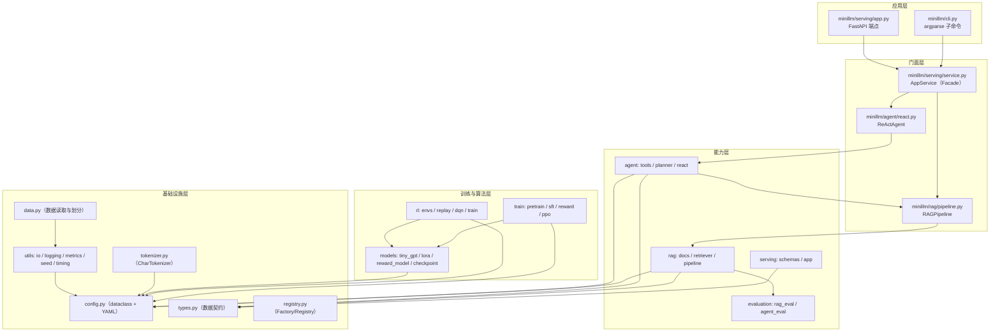
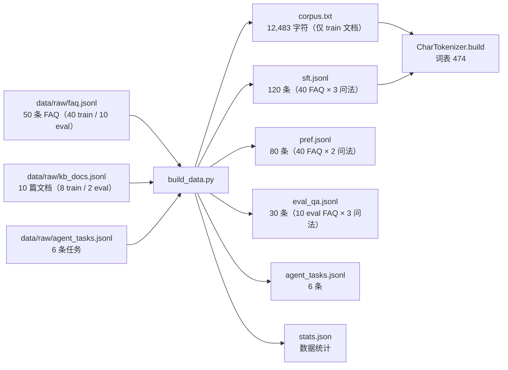
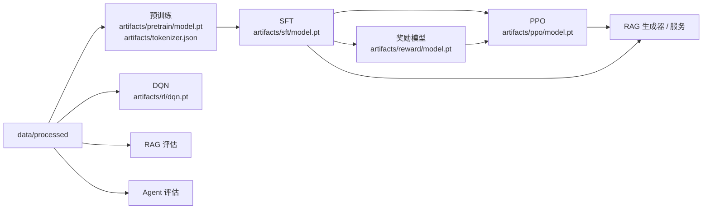
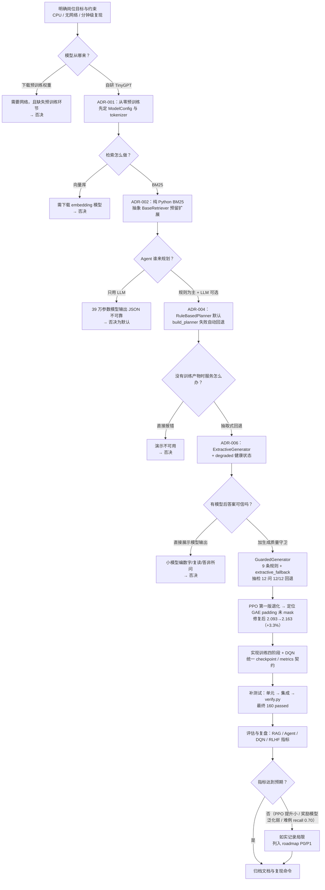

# 设计流程思考

> 本文记录 MiniLLM Studio 的**设计决策过程**：需求如何拆解、方案如何选型、架构如何分层、
> 数据如何构造、开发中踩了哪些坑、测试与可复现性如何保障、以及复盘与后续计划。
>
> 目标读者：面试官 / 项目评审 / 未来的维护者。
> 写作原则：**不美化取舍**——每个「为什么这么选」都写清楚代价，每个「没做到」都如实标注。
> 配套文档：《技术报告》（结果与实验）、《技术参考说明》（技术细节与公式）。

---

## 1. 需求理解：从岗位 JD 到项目能力

### 1.1 目标岗位与 8 条典型要求

目标岗位是**强化学习 / 大模型 / 深度学习算法工程师**。下面 8 条是从该方向 JD 中提炼出的
典型要求（不同公司措辞不同，但能力项高度重合），本项目按条自检，并诚实标注完成度：

* **工业级**：有完整实现、有指标、有测试，经得起追问。
* **演示级**：链路完整、边界清晰，但受算力/数据限制，规模与效果不等同于工业系统。

| # | 岗位要求 | 项目对应能力 | 主要证据（文件 / 指标 / 命令） | 完成度 |
| --- | --- | --- | --- | --- |
| 1 | 扎实的深度学习基础（Transformer、反向传播、优化器、正则化） | 从零实现 pre-LN 因果 Transformer：多头注意力、残差、LayerNorm、权重共享、AdamW + warmup + cosine + 梯度裁剪 | `minillm/models/tiny_gpt.py`；`minillm/train/pretrain.py`；`minillm/train/common.py` → `lr_at_step` | 工业级（规模小） |
| 2 | 大模型训练与微调经验（预训练 / SFT / LoRA / RLHF） | 预训练 → SFT → 奖励模型 → PPO 四阶段全链路；LoRA 可插拔 | `minillm/train/*.py`；`minillm/models/lora.py`；`reports/lm_metrics.json` | 工业级链路，演示级规模 |
| 3 | 强化学习算法能力（值函数、策略梯度、DQN/PPO、探索与稳定性） | GridWorld + DQN（经验回放 / 目标网络 / Double DQN / ε-greedy）；PPO（clip / GAE / token 级 KL / 价值网络） | `minillm/rl/**`；`minillm/train/ppo.py`；`reports/rl_metrics.json` | 工业级（环境小） |
| 4 | 检索增强与知识库工程（BM25 / 向量检索 / 召回评估） | BM25（中英混合 unigram+bigram）、引用溯源、recall@1/@3/MRR 离线评估 | `minillm/rag/**`；`minillm/evaluation/rag_eval.py` | 演示级（无向量库） |
| 5 | Agent / 工具调用 / 多步推理 | ReAct 循环 + 工具注册表（计算器/检索/统计/单位换算）+ 规则与 LLM 双规划器 | `minillm/agent/**`；`minillm/evaluation/agent_eval.py` | 演示级（规则规划为主） |
| 6 | 工程化与部署能力（Python 工程、API、测试、CI） | 分层包结构、FastAPI（7 端点）、pydantic v2 契约、pytest 分层、GitHub Actions、一键验收脚本 | `minillm/serving/**`；`tests/`；`scripts/verify.py`；`.github/workflows/ci.yml` | 工业级（单机） |
| 7 | 数据与实验分析能力（数据构造、指标设计、误差分析） | `raw → processed` 模板化构造、文档级 train/eval 划分防泄漏、指标落盘、失败案例分析 | `scripts/build_data.py`；`data/processed/stats.json`；`reports/*.json` | 工业级（小数据） |
| 8 | 文档与复现能力（技术文档、复盘、可复现实验） | 三份中文文档 + README；种子/配置/产物目录固定；`scripts/verify.py` 一键复现 | `docs/**`；`configs/*.yaml`；`scripts/verify.py` | 工业级 |

### 1.2 项目目标（Scope）

**要做**：

1. 一条**能跑通、能解释、能复现**的大模型对齐链路：预训练 → SFT → 奖励模型 → PPO。
2. 一条**经典 RL** 链路：GridWorld + DQN，用来对比「值函数类」与「策略梯度类」算法。
3. 一条**应用链路**：BM25 检索 + RAG 问答 + ReAct Agent + FastAPI 服务。
4. 离线评估与一键验收，所有指标**如实落盘**（不挑好看的数字）。

**明确不做（非目标）**：

| 非目标 | 原因 |
| --- | --- |
| 训练出「好用」的对话模型 | 39 万参数 + 1.2 万字语料，只可能学到 FAQ 级别的模式复述 |
| 支持 GPU / 分布式 | 评审环境只有 CPU；分布式会引入无法验证的复杂度 |
| 引入向量数据库、embedding 模型 | 需要联网下载模型，违反「零外部依赖」约束 |
| 支持多轮复杂 Agent 规划 | 小模型不具备可靠规划能力，做出来也是「演示幻觉」 |
| 追求 SOTA 指标 | 目标是展示**方法链路与工程判断**，不是刷榜 |

---

## 2. 设计输入：约束条件

设计不是自由的，先把约束写清楚，后面每个决策都能追溯。

| 约束 | 具体内容 | 对设计的影响 |
| --- | --- | --- |
| 算力 | 纯 CPU，模型 < 2M 参数，单次训练 < 3 分钟 | 模型必须极小；训练步数/数据量按「分钟级」裁剪 |
| 依赖 | 只允许 numpy / torch CPU / PyYAML / fastapi / uvicorn / pydantic / pytest / httpx | 不能引入 transformers、faiss、sentencepiece；检索与分词必须自研 |
| 数据 | 无公开数据集下载，只能自造（校园 FAQ 风格） | 需要设计「模板改写 + 文档级划分」的数据构造流程 |
| 网络 | 禁止联网下载 | 不能用预训练权重，必须从零训练 TinyGPT |
| 可复现 | 种子/配置/产物固定，评审可一键跑 | 配置集中化、指标落盘、`verify.py` |
| 交付 | 可运行项目 + 四份中文文档（README 由 Lead 维护） | 代码要有 docstring、设计模式、测试；文档要可验收 |
| 协作 | 多人分工（core / RL / LLM / App / Docs），有写入边界 | 接口先行（`types.py` 数据契约、`config.py` 配置契约） |

---

## 3. 方案选型：对比与 ADR

### 3.1 选型对比总表

| 决策点 | 方案 A | 方案 B | 选择 | 核心理由 |
| --- | --- | --- | --- | --- |
| 语言模型 | 自研 TinyGPT（39 万参数，从零训练） | 下载开源预训练模型（如 Qwen-0.5B） | **A** | 零网络依赖；可完整展示预训练/对齐链路；面试可讲清每个张量 |
| 分词 | 字符级 Tokenizer | BPE / SentencePiece | **A** | 无需训练子词模型，中文无歧义，OOV 率低；代价是序列变长 |
| 检索 | BM25（纯 Python） | 向量检索（embedding + ANN） | **A** 为主，**B** 预留接口 | 60 个 chunk 规模下 BM25 够用且零依赖；`BaseRetriever` 已为 B 预留策略位 |
| 训练环境 | CPU + 小数据 + 固定预算 | GPU + 大数据 | **A** | 评审环境只有 CPU；小数据能保证「分钟级复现」 |
| Agent 规划 | 规则规划器（默认） | LLM 规划器（可选） | **A 默认，B 可选** | 小模型规划不可靠；规则规划确定、可测、可解释；LLM 路径保留作工程演示 |
| 架构 | 单仓分层（`minillm/` 十个子包） | 微服务（训练/检索/Agent 拆服务） | **A** | 单人可以维护；服务拆分只会增加联调成本，收益为零 |
| 生成回退 | 抽取式回退（明确标注 source） | 直接报错 / 假装生成 | **A** | 保证「没有模型也能演示检索链路」，且不欺骗调用方 |
| 配置 | dataclass + YAML 局部覆盖 | 纯 argparse / Hydra | **A** | 类型安全、未知字段报错、可序列化落盘；避免引入重依赖 |

### 3.2 ADR-001：自研 TinyGPT 而不是下载预训练模型

**背景**
岗位要求「大模型训练/微调」经验，但约束是禁止联网、CPU、单次训练 3 分钟内。

**选项**

* A. 下载开源权重（Qwen / TinyLlama 等）做 SFT/LoRA：效果下限高，但需要网络；
  且「预训练」环节缺失，无法展示从零构建语言模型的能力。
* B. 自研 decoder-only TinyGPT，从零预训练：效果上限低，但全链路可控、可解释。

**决策**：选 B。预训练、SFT、奖励模型、PPO 四个阶段都基于同一个 TinyGPT 结构，
奖励模型与价值网络通过 `forward_hidden` 复用同一个 backbone，代码复用率最高。

**代价**

* 生成质量差：字符级 + 39 万参数，PPO 后的输出仍可能出现重复/无意义片段（见《技术报告》失败案例）。
* 不能宣称「具备通用语言能力」，只能声称「跑通了对齐链路并得到可量化指标」。

**复审条件**：如果允许联网且评审关注「效果」，应改为下载 0.5B 级模型，只做 SFT + LoRA + DPO/PPO。

### 3.3 ADR-002：BM25 而不是向量检索

**背景**
RAG 需要一个检索器，知识库只有 60 个 chunk（FAQ 50 + 知识文档 10）。

**选项**

* A. BM25：纯 Python，零依赖，可解释（能看到哪些词命中、IDF 多少）。
* B. 向量检索：需要 embedding 模型（联网下载）或自训 embedding（数据量不够），
  且 ANN 索引在 60 篇规模下没有性能收益。

**决策**：选 A，同时把检索器抽象成 `BaseRetriever` + `RETRIEVER_REGISTRY`，
未来加 `dense` 实现只需要注册一个工厂函数，不改上层 `RAGPipeline`。

**代价**

* 同义改写、跨语言查询会漏召回；`recall@3` 的上限由词法重叠决定。
* 没有语义相似度，无法处理「换一种说法但意思相同」的问题。

**复审条件**：知识库超过 1 万 chunk、或出现大量同义查询时，引入 embedding + 混合检索（BM25 + dense）。

### 3.4 ADR-003：CPU + 小数据 + 固定训练预算

**背景**
评审环境是普通笔记本，不能要求 GPU；但又要「可复现的小时级交付」。

**选项**

* A. 完整数据 + 大模型 + GPU：效果好，但评审跑不起来。
* B. 小数据（1.2 万字语料、120 条 SFT、80 条偏好）+ 39 万参数 + 固定步数：几分钟内跑完。

**决策**：选 B。所有训练器都把「步数/epoch/评估频率」写进配置，默认配置在 CPU 上
pretrain 约 22 秒、SFT 约 2 秒、奖励模型约 6 秒、PPO 80 步约 13 秒、DQN 约 2 秒（实测见
`reports/lm_metrics.json`、`reports/rl_metrics.json` 的 `elapsed_sec`）。

**代价**

* 预训练只做了 300 步（61.4 万 token），模型远未收敛到「语言能力」层面；
  **SFT/PPO 的效果主要来自数据模式，而不是语言理解**。
* 指标波动大：奖励模型、PPO 的指标在小数据上对种子敏感。

**复审条件**：有 GPU 时，把 `max_steps` 提到 1 万+、语料扩到百万字，再重跑全链路。

### 3.5 ADR-004：规则规划器默认，LLM 规划器可选

**背景**
Agent 需要一个「决定下一步调用哪个工具」的规划器。

**选项**

* A. 规则规划器：关键词/正则识别意图，确定性强，可单测；但只能覆盖设计好的意图。
* B. LLM 规划器：TinyGPT 输出 JSON；灵活但 39 万参数模型基本无法稳定输出合法 JSON。

**决策**：A 为默认（`cfg.agent.planner="rule"`），B 作为可选实现保留，
`build_planner` 在 LLM 不可用/加载失败时**自动回退**规则规划器。

**代价**

* 规则规划器的「智能」有限，遇到没见过的任务类型会走「检索 + 汇总」的兜底路径。
* LLM 规划器目前只是工程闭环演示，不应被当作有效能力宣传。

**复审条件**：换成 7B 级模型（或调用外部 LLM API）后，用 few-shot + 结构化输出约束再启用 LLM 规划器。

### 3.6 ADR-005：单仓分层而不是微服务

**背景**
项目包含训练、RL、RAG、Agent、服务五块能力，天然可以拆成多个服务。

**选项**

* A. 单仓分层：一个 Python 包 `minillm/`，按领域分子包，进程内调用。
* B. 微服务：训练服务 / 检索服务 / Agent 服务 / 网关，通过 HTTP/gRPC 通信。

**决策**：选 A。理由：单机 CPU 环境下，拆服务只会带来序列化、联调、部署三类成本，
而没有任何弹性/独立扩缩容收益；分层已经足够表达边界。

**代价**

* 训练与推理共享进程依赖（torch），服务镜像会比较重。
* 模块间是进程内函数调用，缺少网络边界带来的「强制解耦」；靠目录约定 + 代码评审维持边界。

**复审条件**：需要独立扩缩容（如检索 QPS 远高于生成）时，按 `rag/`、`agent/`、`serving/`
的现有边界拆服务即可，接口几乎不用改。

### 3.7 ADR-006：三级降级 + 生成质量守卫

**背景**
「全新克隆仓库」时没有任何训练产物；有产物时，字符级小模型的自由生成也可能
编数字、复读、答非所问。RAG 对事实性要求高，不能把不可信输出直接给用户。

**选项**

* A. 直接报错 / 直接展示模型输出：前者服务不可用，后者会误导用户。
* B. 三级降级：无模型 → `ExtractiveGenerator`（`source="extractive"`）；
  有模型 → `GuardedGenerator` 校验，不合格 → `ExtractiveGenerator`（`source="extractive_fallback"`）；
  通过 → 模型输出（`source="model"`）。

**决策**：选 B（ADR 演进过程：最初只有 A/B 两态的抽取式回退，
后来补上「模型输出质量守卫」，形成三级降级）。守卫规则全部是简单可解释的词法/正则判断
（长度、上下文覆盖率、数字接地、重复度、占位文本、数量型问题是否含数字），
不合格就回退，并用 `source` 字段明确标注来源。

**代价**

* 守卫是**词法级兜底**，拦不住语义级答非所问（例如问「为什么」答了一个相关但不解释原因的事实句）；
* 守卫会让「模型生成的展示比例」下降——多数 RAG 问答可能回退到抽取式，
  这降低了「模型能力」的观感，但换来了答案可靠性；
* 需要额外测试覆盖「通过 / 拦截 / 生成异常 / 无模型」四条路径，规则阈值也要有人工校准。

**复审条件**：模型换大后，守卫规则应放宽或改为「模型输出 + 引用校验」，
并引入答案级评估（NLI / 人工）替代纯词法规则。

---

## 4. 架构与设计模式

### 4.1 分层架构



**依赖规则**（评审时可以直接对照 import 检查）：

1. **单向依赖**：上层可以 import 下层，反之不允许（`types.py` 不 import 任何 minillm 模块）。
2. **配置集中**：所有超参只能来自 `ProjectConfig`，训练/服务代码不写魔法数字。
3. **契约先行**：跨模块通信只用 `minillm/types.py` 的 dataclass（`Document` / `SearchHit` /
   `GenerationResult` / `ToolResult` / `AgentStep` / `AgentTrace` / `RAGAnswer`）。
4. **延迟加载**：训练器与 `TinyGPTGenerator` 内部才 import torch，
   保证「没有 torch 也能用检索/Agent/服务」的降级路径（`minillm/rag/pipeline.py:392`、`minillm/cli.py`）。

### 4.2 设计模式落点（代码级）

| 模式 | 落点 | 具体表现 | 收益 |
| --- | --- | --- | --- |
| **Strategy** | `rag/retriever.py` → `BaseRetriever` / `BM25Retriever` | 检索算法可替换 | 未来加向量检索不动上层 |
| **Strategy** | `rag/pipeline.py` → `BaseGenerator` / `ExtractiveGenerator` / `TinyGPTGenerator` | 生成算法可替换 | 无模型回退、模型上线平滑切换 |
| **组合 / 装饰器** | `rag/pipeline.py` → `GuardedGenerator` | 包装主生成器，输出不合格时切换到回退生成器并改写 `source` | 不改动生成器实现即可加「质量拦截」 |
| **Strategy** | `agent/planner.py` → `BasePlanner` / `RuleBasedPlanner` / `LLMPlanner` | 规划算法可替换 | 规则与 LLM 双实现，失败自动回退 |
| **Strategy** | `agent/tools.py` → `BaseTool` 及四个工具 | 工具可插拔 | 新增工具只需实现 `run` 并注册 |
| **Factory + Registry** | `minillm/registry.py` → `Registry[T]` | 名字 → 工厂函数 | 统一「按配置字符串创建对象」 |
| **Factory + Registry** | `RETRIEVER_REGISTRY` / `GENERATOR_REGISTRY` / `TOOL_FACTORY` | `@register("bm25")` 装饰器注册 | 配置驱动装配 |
| **Factory** | `rl/envs.py` → `create_env`；`rl/dqn.py` → `create_agent` | 由 cfg 与 env 规格创建对象 | 训练/评估共用装配逻辑 |
| **Template Method（函数式）** | `train/common.py` + 四个 `run_*` | 固定编排：`resolve_dirs → load_tokenizer → 训练 → 评估 → save_model → save_metrics`；各训练器只覆盖数据/模型/循环细节 | 四阶段行为一致、指标字段一致 |
| **Adapter** | `rag/pipeline.py` → `TinyGPTGenerator` | 把 `TinyGPT` + `CharTokenizer` 适配成 `BaseGenerator` 接口 | 服务层不感知模型细节 |
| **Adapter（结构复用）** | `models/reward_model.py` → `RewardModel`；`train/ppo.py` → `ValueModel` | 同一 TinyGPT backbone 接不同标量头 | 共享预训练表示 |
| **Facade** | `serving/service.py` → `AppService` | HTTP 层只调 `health/stats/rag_*/agent_run/generate/chat` | 端点极薄、易测 |
| **Singleton（容器）** | `serving/app.py` → `app.state.service` | 每个应用实例持有唯一 `AppService` | 组件只初始化一次 |
| **Builder（轻量）** | `rag/pipeline.py` → `build_rag_pipeline`；`agent/tools.py` → `build_tools` | 组装复杂对象图 | 调用方一行拿到可用组件 |

**一个具体例子**：新增一个「维基检索工具」只需要三步——

```python
# 1) 实现工具
class WikiTool(BaseTool):
    name = "wiki_search"
    description = "检索维基百科"
    def run(self, query: str = "", **kwargs) -> ToolResult: ...

# 2) 注册工厂
@TOOL_FACTORY.register("wiki_search")
def _create_wiki(**_: Any) -> BaseTool:
    return WikiTool()

# 3) 配置启用：agent.tools 加一项即可，无需改 ReActAgent / AppService
```

### 4.3 关键接口契约

| 契约 | 位置 | 约定 |
| --- | --- | --- |
| 配置树 | `minillm/config.py` → `ProjectConfig` | YAML 局部覆盖；未知字段/未知配置节直接 `ConfigError`；`validate()` 做合法性检查 |
| 数据契约 | `minillm/types.py` | 全部 `dataclass`；`to_dict()` 保证 JSON 可序列化 |
| 检查点契约 | `minillm/models/checkpoint.py` | `{version, kind, config, state_dict, meta}`；`kind ∈ {gpt, policy, reward}` |
| 指标契约 | `minillm/utils/metrics.py` → `save_metrics` | 按 section 合并写 `reports/*.json`，多次训练互不覆盖 |
| 服务契约 | `minillm/serving/schemas.py` | 请求空白串 → 422；统一错误体 `{"error": {"type", "message"}}` |
| 训练器契约 | `minillm/train/*.py` | `run_*(cfg, processed_dir=None, artifacts_dir=None) -> dict`，指标字段见《团队契约》§3.3 |

---

## 5. 数据构造流程

### 5.1 流程总览



数据统计（`data/processed/stats.json`）：

| 字段 | 值 | 含义 |
| --- | --- | --- |
| `num_docs` / `num_docs_train` | 10 / 8 | 知识库文档总数 / 训练划分 |
| `num_faq` / `num_faq_train` / `num_faq_eval` | 50 / 40 / 10 | FAQ 总数与划分 |
| `num_sft` | 120 | SFT 样本数 |
| `num_pref` | 80 | 偏好样本数 |
| `num_eval_qa` | 30 | RAG 评估查询数 |
| `num_agent_tasks` | 6 | Agent 评估任务数 |
| `corpus_chars` | 12,483 | 预训练语料字符数 |
| `vocab_hint` | 465 | 语料中不重复非空白字符数（实际词表 474 含 4 特殊 token + SFT 额外字符） |

### 5.2 模板改写（paraphrase）

真实用户不会只用一种问法。`scripts/build_data.py` → `paraphrase` 对每个问题生成 3 种表达：

```text
原问题：第一食堂早餐几点开始？
改写 1：第一食堂早餐几点开始？
改写 2：请问第一食堂早餐几点开始？
改写 3：我想知道第一食堂早餐几点开始。
```

**为什么这么做**：让 SFT/检索器见过多种口语化表达，评估集也用同一套改写模板，
保证「训练分布」与「评估分布」一致（评估的是泛化到不同问法的能力，而不是背诵原问题）。

**局限**：模板改写只改变前后缀，不改变用词。因此评估集对 BM25 是「友好」的——
字符重叠很高。这会让 RAG 的 recall 看起来很好，但**不能证明语义检索能力**，
这一点在《技术报告》结果分析里会明确说明。

### 5.3 训练/评估划分与防泄漏

泄漏是评测作品最容易翻车的地方，本项目在三个层面做了隔离：

1. **文档级划分**：`kb_docs.jsonl` 的 `split` 字段决定 FAQ 归属；`kb-campus-07`（西安生活指南）
   与 `kb-campus-10`（医疗与校园安全）整体属于 eval，其余 8 篇属于 train。
2. **语料只含 train**：`corpus.txt` 由 `train_docs` 的摘要 + `train_faq` 的多种问法拼成，
   **eval 文档的文本不会进入预训练语料**。
3. **评估集只含 eval**：`eval_qa.jsonl` 只从 10 条 eval FAQ 生成；RAG 评估的 gold 是父文档
   `doc_id`，与训练时的 SFT/prompt 无重叠。

**残余风险（诚实记录）**：

* FAQ 的**答案**在 train 文档摘要里往往有相同数字（例如「8000 元/年」），
  所以 RAG 检索到 train 文档也可能命中关键词——评估只看 gold 父文档，能识别这种「碰巧」。
* 知识库只有 10 篇，eval 只占 2 篇，评估集规模小（30 条查询），指标置信区间很宽。

### 5.4 偏好数据构造

`pref.jsonl` 的构造：

* `chosen` = 该 FAQ 的正确答案；
* `rejected` = 从**同属 train 划分、但 doc_id 不同**的 FAQ 里随机抽的答案（`random.Random(0)`）；
* 每条问题取前 2 种改写，共 40 × 2 = 80 条。

**好处**：rejected 是「答非所问」而不是「语法错误」，奖励模型学到的是「答案是否匹配问题」，
这正是 PPO 需要的信号。

**风险**：任务过于简单——rejected 来自完全不同的主题，奖励模型很容易达到高准确率，
但这不代表它能分辨「同一问题下两个都相关、但一个更好的答案」。这是奖励模型泛化能力的天花板，
也是 PPO 效果有限的原因之一（详见《技术报告》§7）。

---

## 6. 训练流水线设计

### 6.1 阶段依赖



**设计要点**

* **依赖显式化**：SFT 找不到 `pretrain/model.pt` 直接报错并提示先跑预训练；
  PPO 同时校验 `sft` 与 `reward` 两个检查点（`minillm/train/ppo.py:302`）。
  不做「找不到就随机初始化」的静默降级，避免产出不可解释的指标。
* **词表一致性校验**：SFT / 奖励模型 / PPO 都检查 `model.cfg.vocab_size == tokenizer.vocab_size`，
  防止用旧词表解码新模型。
* **检查点统一格式**：`save_model` / `load_model` 是所有阶段的唯一出入口，
  服务端不需要知道训练细节。

### 6.2 指标与产物约定

| 阶段 | 模型产物 | 指标文件 | 关键字段 |
| --- | --- | --- | --- |
| 预训练 | `artifacts/pretrain/model.pt`、`artifacts/tokenizer.json` | `reports/lm_metrics.json` → `pretrain` | `steps, final_loss, val_loss, val_ppl, tokens, elapsed_sec, params` |
| SFT | `artifacts/sft/model.pt` | `reports/lm_metrics.json` → `sft` | `epochs, final_loss, val_loss, val_ppl, elapsed_sec, use_lora` |
| 奖励模型 | `artifacts/reward/model.pt` | `reports/lm_metrics.json` → `reward` | `final_loss, val_acc, val_margin, elapsed_sec, best_epoch, data_aug, augmented_pairs, train_pairs` |
| PPO | `artifacts/ppo/model.pt`、`reports/ppo_samples.json` | `reports/lm_metrics.json` → `ppo` | `steps, mean_reward_before, mean_reward_after, mean_kl, mean_entropy, best_step, mean_reward_final, elapsed_sec, samples`；样本文件另含 `baseline_samples` |
| DQN | `artifacts/rl/dqn.pt` | `reports/rl_metrics.json` → `dqn`；曲线 `reports/rl_curve.json` | `episodes, final_success_rate, best_success_rate, avg_return_last20, total_updates` |
| RAG 评估 | — | `reports/app_metrics.json` → `rag` / `rag_hard` | `num_queries, recall@1, recall@3, mrr, avg_latency_ms` |
| Agent 评估 | — | `reports/app_metrics.json` → `agent` | `num_tasks, success_rate, avg_steps, avg_latency_ms, details` |
| RAG 生成守卫 | — | 无独立指标文件 | 运行时写入 `RAGAnswer.source`（`model` / `extractive_fallback`），`/health.generator` 反映当前生成器 |

### 6.3 时间预算（实测）

| 阶段 | 配置 | 实测耗时 | 数据来源 |
| --- | --- | --- | --- |
| 预训练 | `configs/default.yaml`（300 步） | 21.77 s | `reports/lm_metrics.json` → `pretrain.elapsed_sec` |
| SFT | `configs/default.yaml`（6 epoch） | 2.25 s | `reports/lm_metrics.json` → `sft.elapsed_sec` |
| 奖励模型 | `configs/default.yaml`（6 epoch + 120 条派生负例） | 5.74 s | `reports/lm_metrics.json` → `reward.elapsed_sec` |
| PPO | `configs/default.yaml`（80 步） | 12.94 s | `reports/lm_metrics.json` → `ppo.elapsed_sec` |
| DQN | `configs/default.yaml`（150 回合） | 2.06 s | `reports/rl_metrics.json` → `dqn.elapsed_sec` |

> 说明：以上耗时均为 `configs/default.yaml` 最终版实测值（CPU），合计约 44.8 秒；
> `configs/quick.yaml` 适合 CI 冒烟，耗时可压到数秒。
> README §5.3 的命令与耗时与此一致。

---

## 7. 开发过程中的问题与解决

下面每一条都是真实踩坑，按「现象 → 根因 → 解决 → 代码位置」记录，便于面试时展开讲。

### 7.1 DQN 原版 max-target 导致训练末期策略回退

**现象**：最初用原始 DQN 目标 `y = r + γ·max_a' Q_target(s', a')`，成功率在中期达到峰值后
回落，最终模型反而不如中间 checkpoint。

**根因**：`max` 算子对估计噪声取上界，产生系统性高估；目标网络每 20 步才同步一次，
高估误差在两次同步之间累积，导致 Q 值整体漂移。

**解决**：改成 **Double DQN**——在线网络选动作、目标网络估值
（`minillm/rl/dqn.py:129-131`）。同时：

* 用 Huber（`smooth_l1`）损失代替 MSE，降低离群 TD 误差的影响；
* 梯度裁剪 `GRAD_CLIP_NORM=10.0`；
* 以 `(成功率, 平均回报)` 字典序保存最优模型，而不是保存最后一步（`minillm/rl/train.py:164`）。

**结果**：`reports/rl_metrics.json` 显示最终成功率 1.0、best 1.0、best_episode=25，
训练末期不再回退。**但训练中期仍有一次真实波动**：`reports/rl_curve.json` 里 episode 50 的
greedy 评估成功率为 0.0、50 步超时，随后 75 回合恢复到 8 步最优。这验证了一个工程判断——
**不能假设值函数训练单调变好**，因此必须「周期性评估 + 保存最优 checkpoint」，并单独记录终评。

**算法选择的量化依据**：开发中用 5 个随机种子对比原版 DQN 与 Double DQN——
原版 `max` 目标只有 **2/5** 个种子最终收敛，Double DQN 为 **5/5**。
这比「论文说 Double DQN 更好」更有说服力，也是本项目选型的直接证据。

### 7.2 PPO 退化根因：GAE 对 padding 未 mask（修复后转为提升）

**现象**：PPO 第一版不但没提升，反而把评估奖励从 **−0.859007** 拉到 **−1.172874**；
样本出现 `9:0-9:0-9:0`、`2充值」Ap 充值」Ap` 这类退化，且部分退化样本仍拿到正奖励分。

**根因（这是本项目最关键的一次排障）**：`_compute_gae` 处理变长序列时，
右侧 padding 位置的 `r_t`、`V(s_t)` 没有实际意义，但旧实现只对 `advantages` 乘了 mask，
**没有把 `δ_t` 与 `A_t` 一起清零**：

```python
# 旧实现（有 bug）：padding 的 delta 仍参与递推
delta = rewards[:, t] + gamma * next_value - value_t
last_gae = delta + gamma * lam * last_gae
advantages[:, t] = last_gae * mask[:, t]

# 新实现（minillm/train/ppo.py:203-229）：δ 与 A 都乘 mask
m = mask[:, t]
delta = (rewards[:, t] * m) + gamma * next_value - values[:, t] * m
last_gae = (delta + gamma * lam * last_gae) * m
```

GAE 沿时间**反向**递推，padding 噪声会以 `γλ` 的权重一路污染到前面有效 token 的优势，
策略更新方向因此错误。这类 bug 不报错、不 NaN，只会让指标悄悄变差——**最难查的一类问题**。

**修复（三项一起上）**：

1. `δ_t` / `A_t` 在 padding 位置清零，token 奖励也显式乘 mask；
2. 奖励模型加入 120 条 SFT 派生难负例（train 64 → 184，val_acc 0.625 → 0.8125）；
3. 按 greedy 评估保留最优检查点（step 0 的 SFT 策略也是候选），并记录
   `best_step` / `mean_reward_final`；评估 prompt 改为 `seed+7` 从全部 prompt 抽 8 条（覆盖不同主题）。

**修复后结果**：`mean_reward_before=2.093439`、`mean_reward_after=2.163445`、
`best_step=80`、`mean_kl=0.008476`、`mean_entropy=0.401922` —— 从退化变为 **+0.070（+3.3%）** 的提升。
提升幅度不大（KL 很小、策略贴近 SFT、奖励模型对数字仍不敏感），但方向对了；
更重要的是**排障过程可复现、可解释**。完整分析见《技术报告》§6.2、§7.1。

**同时保留的稳定性措施**：`ratio` 做 `.clamp(-20,20)`；策略/价值独立优化器
（`lr=2e-5` / `value_lr=5e-4`）；优势归一化只用有效 action 且 `std` 下限 `1e-6`；
参考策略与奖励模型冻结。

### 7.3 没有检查点时的回退设计（三级降级）

**现象**：全新克隆的仓库没有 `artifacts/`，直接 `AppService()` 会因加载模型失败而崩溃；
有检查点时，小模型输出又可能不可信（见 §7.11）。

**根因**：RAG 流水线强依赖生成模型，但演示/测试常常只需要检索能力；
而「有模型」也不等于「答案可信」。

**解决**（三级降级）：

* `TinyGPTGenerator.is_ready(cfg)` 只检查文件是否存在，**不 import torch**（`rag/pipeline.py:370`）；
* 无检查点（或加载失败且 `allow_fallback=True`）→ `ExtractiveGenerator`（`source="extractive"`）；
* 有检查点 → 默认包 `GuardedGenerator`（`cfg.rag.guard_model_output=True`）：
  校验不通过 → `ExtractiveGenerator`（`source="extractive_fallback"`），通过 → `source="model"`；
* `AppService` 初始化失败时记录 `_rag_error`，`health()` 返回 `status="degraded"`，
  检索接口返回 503 而不是让进程崩溃（`serving/service.py` → `AppService.__init__`）；
* CLI 的 `smoke` 命令不依赖任何 checkpoint（`cli.py:189`）。

**验证**：`python -m minillm smoke` 在没有 `artifacts/` 的机器上也能通过。

### 7.4 词表与检查点不一致

**现象**：先用一份 tokenizer 训练，后来重新构建数据导致词表变化，SFT 加载旧检查点时
`load_state_dict` 报维度不匹配，或更糟——静默用错误 id 解码。

**解决**：所有下游阶段加载模型后立即校验
`model.cfg.vocab_size == tokenizer.vocab_size`，不一致直接抛 `ValueError`
（`train/sft.py:141`、`train/reward.py:163`、`train/ppo.py:308`）。
`CharTokenizer.save/load` 带 `version` 字段，特殊 token id 契约变化时拒绝加载（`tokenizer.py:168`）。

### 7.5 SFT 的 loss mask 与 padding

**现象**：最初把 prompt 也计入损失，模型学到的是「复述问题」，回答质量差。

**解决**：`pad_sft_batch` 把 prompt 与 padding 位置的标签设为 `-100`
（`F.cross_entropy(ignore_index=-100)`）；每个 batch 训练前检查
`(y != -100).sum() == 0` 的空 batch 并跳过，避免全 `-100` 时 loss 为 NaN（`train/sft.py:171`）。
另外 `encode_sft_example` 超长时**优先截断 prompt 开头**、保留 `答：` 附近内容，
保证 response 至少有一个 token 参与训练（`train/sft.py:44-50`）。

### 7.6 奖励模型如何取「最后一个有效 token」

**现象**：batch 内序列长度不一，右填充的 pad 位置会污染「最后位置」的 hidden。

**解决**：`RewardModel.forward` 用 `mask.sum(dim=1) - 1` 定位每条序列最后一个有效 token
（`models/reward_model.py:56-63`）；前提是 mask 为「左侧连续的 1」，这与
`pad_reward_batch` 的右填充实现一致（`train/reward.py:54-67`）。

### 7.7 pydantic v2 迁移与错误体序列化

**现象**：把 v1 的 `@validator` 迁到 v2 后，`RequestValidationError.errors()` 里的 `ctx`
可能包含 `ValueError` 对象，直接 `JSONResponse(content=exc.errors())` 会 500。

**解决**：改用 `@field_validator`（`serving/schemas.py`）；错误处理器只保留
`{loc, msg, type}` 三个字段并全部 `str()` 化（`serving/app.py:78-90`）。

### 7.8 测试不能依赖 `data/processed/`

**问题**：如果测试直接读真实数据，CI 必须先跑 `build_data.py`，且数据一改测试就挂。

**解决**：`tests/conftest.py` 提供 `tiny_cfg`（1 层、32 维、2 步训练）与 `repo_root`；
所有训练测试用 `tmp_path` 自造小语料/JSONL；`scripts/verify.py` 负责真实数据的端到端链路。
CI 仍然会先构建数据再跑测试，覆盖「真实数据可加载」这一层。

### 7.9 指标文件互相覆盖

**问题**：四个训练阶段都写 `reports/lm_metrics.json`，如果直接 `write_json` 会互相覆盖。

**解决**：`minillm/utils/metrics.py` → `save_metrics(path, section, payload)` 先读旧内容、
按 section 合并再写；`verify.py` 最后扫描 `reports/*_metrics.json` 汇总。

### 7.10 CPU 时间预算与「可复现」的平衡

**问题**：评审注意力有限，全链路必须几分钟内跑完；但步数太少指标没有意义。

**解决**：

* 默认配置面向「可复现演示」：预训练 300 步 / 61.4 万 token，全链路 < 1 分钟；
* 另提供 `configs/quick.yaml`（30 步 / 1 epoch / PPO 3 步）用于 CI 与冒烟；
* 所有耗时写进指标文件（`elapsed_sec`），读者可以自己判断成本。

### 7.11 小模型生成不可信 → 生成质量守卫 + 三级降级

**现象**：有检查点之后，RAG 问答直接使用 TinyGPT 输出，出现三类问题：
① 编造数字（「营业到 217:30」「电话 8260 9999」）；
② 复读（`7:0-9:0-9:0`）；
③ 答非所问/碎片（问「图书馆周五几点闭馆」答「图书馆一层为自习区」；
   或输出「图书馆 7 7 7 7 3:0。」「第一次0。」这类语法碎片）。

**根因**：392K 参数 + 字符级词表的小模型不具备稳定的事实组合能力；
而 RAG 对事实性要求高，直接展示会误导用户。

**解决**（`minillm/rag/pipeline.py` → `GuardedGenerator`，组合/装饰器模式）：

* 模型输出依次通过 **9 条简单可解释的规则**（按代码检查顺序）：
  占位文本 → 最短长度（≥4 有效字符）→ 整段上下文覆盖率（≥0.6）→
  单片段覆盖率（≥0.75，防多片段拼接）→ 数字接地（答案数字必须在 context 中）→
  重复检测（连续同字符 ≤4、重复 4-gram 比例 <0.5）→
  数量型问题必须含数字（`missing_quantity`）→ 答案与问题至少共享一个 2-gram
  （`missing_question_anchor`）→ 与最相似片段的最长连续匹配 ≥ 答案长度 75%
  （`max_chunk_similarity`，放在最后兜底）；
* 任一不满足或生成异常 → 回退 `ExtractiveGenerator`，`source="extractive_fallback"`；
  通过 → `source="model"`；
* `/health.generator` 暴露 `model_guarded` / `model` / `extractive` / `unavailable`；
  `/v1/generate` 是裸模型演示、不经过守卫，RAG 问答才经过守卫。

**实测结论**：抽检 **12 个常见问题**（图书馆闭馆、食堂时间、报修电话、奖学金金额、校医院、
校园网等），**12/12 全部触发守卫回退**，RAG 输出均为正确的抽取式答案并带 citations。
这是**预期取舍**——RAG 对事实性要求高，宁可用检索原文也不展示不可信生成；
模型生成能力通过 `/v1/generate` 单独演示，训练/对齐效果看 `reports/*.json`。

**代价与边界（诚实记录）**：

* 守卫是**词法级兜底**，拦不住语义级答非所问（例如问「为什么」答了一个相关但不解释原因的事实句）；
* 12/12 回退意味着 demo 中 RAG 答案基本来自检索原文，降低「模型能力」的观感，但换来答案可靠性；
* 规则阈值需要人工校准，换更大模型后应放宽或改为答案级评估（NLI/人工）。

**验证**：`tests/test_rag_pipeline.py` 覆盖「通过 / 各类拦截 / 生成异常 / 无模型 / 守卫关闭」路径；
全仓最终 **160 passed**（含 9 条守卫规则测试）。

---

## 8. 测试与验收策略

### 8.1 测试分层

| 层 | 覆盖对象 | 代表文件 | 断言重点 |
| --- | --- | --- | --- |
| 单元 | 分词器 | `tests/test_tokenizer.py` | 编解码往返、特殊 token、unk、构建顺序确定性、保存/加载 |
| 单元 | 模型 | `tests/test_models.py` | 前向形状、因果性（未来 token 不影响当前 logits）、权重共享、LoRA 注入/合并等价、检查点往返 |
| 单元 | RL 环境 | `tests/test_rl_env.py` | reset/step/render、撞墙、陷阱、超时截断、观测 one-hot |
| 单元 | 回放池 | `tests/test_rl_replay.py` | 容量、FIFO 覆盖、采样形状、样本不足报错 |
| 单元 | DQN | `tests/test_rl_dqn.py` | 网络形状、ε-greedy/greedy、update 前后参数变化、目标同步、存取 |
| 单元 | RAG 文档 / 检索 / 流水线 | `tests/test_rag_docs.py`、`test_rag_retriever.py`、`test_rag_pipeline.py` | FAQ/KB 转换、BM25 排序与摘要、上下文拼接、抽取式回退、引用、**生成守卫 9 条规则与回退路径** |
| 单元 | Agent 工具 / 循环 | `tests/test_agent_tools.py`、`test_agent_react.py` | 计算器 AST 白名单、单位换算、工具注册表异常收敛、ReAct 步数/兜底 |
| 单元 | 服务 / CLI | `tests/test_serving.py`、`test_cli.py` | 端点状态码与错误体、空白串 422、CLI 子命令解析 |
| 集成 | 预训练 | `tests/test_train_pretrain.py` | 2 步内完成、产物存在、指标字段有限 |
| 集成 | SFT | `tests/test_train_sft.py` | loss mask、LoRA 合并、产物与指标 |
| 集成 | 奖励模型 | `tests/test_train_reward.py` | BT loss、验证准确率、产物格式 |
| 集成 | PPO | `tests/test_train_ppo.py` | 1 步更新、指标与样本落盘 |
| 集成 | DQN 训练 | `tests/test_rl_train.py` | 短训练可完成、指标完整、曲线落盘 |
| 端到端 | 全链路 | `scripts/verify.py`、`python -m minillm smoke` | 每步 PASS/FAIL、汇总写 `reports/verify_report.json` |

> 当前全仓 `python -m pytest tests`：**160 passed**（含 9 条生成守卫规则测试），见 README §6.5。

### 8.2 验收标准映射

| 验收项 | 命令 | 通过判据 | 产物 |
| --- | --- | --- | --- |
| 数据可构建 | `python scripts/build_data.py` | 退出码 0，`data/processed/*` 齐全 | `stats.json` |
| 四阶段训练 | `python scripts/train_{pretrain,sft,reward,ppo}.py` | 退出码 0，指标字段齐全 | `artifacts/**/model.pt`、`reports/lm_metrics.json` |
| RL 训练 | `python scripts/train_dqn.py` | 退出码 0，终评 ≥ 20 回合 | `reports/rl_metrics.json`、`rl_curve.json` |
| RAG 评估 | `python scripts/eval_rag.py` | 指标字段齐全且为有限数 | `reports/app_metrics.json` → `rag` |
| Agent 评估 | `python scripts/eval_agent.py` | 成功率与 details 齐全 | `reports/app_metrics.json` → `agent` |
| 服务可用 | `python -m minillm serve` + `curl /health` | `status ∈ {ok, degraded}`，不崩溃 | HTTP 200 |
| 冒烟 | `python -m minillm smoke` | 退出码 0，`ok=true` | stdout JSON |
| 单元测试 | `python -m pytest tests` | **160 passed**（允许 `slow`） | pytest 输出 |
| 一键验收 | `python scripts/verify.py` | 汇总 PASS，退出码 0 | `reports/verify_report.json` |

### 8.3 CI

`.github/workflows/ci.yml`：push/PR 触发，Python 3.11，安装 `requirements.txt` →
`python scripts/build_data.py` → `python -m pytest tests -q`。

**与本地差异（诚实记录）**：本地开发用 Python 3.13，CI 用 3.11（`pyproject.toml` 要求 `>=3.10`）。
两者都验证通过；CI 不跑完整训练（只跑单测），完整训练由 `scripts/verify.py` 在本地/评审环境执行。

---

## 9. 可复现性

### 9.1 种子策略

| 阶段 | 种子 | 位置 |
| --- | --- | --- |
| 预训练 | 42 | `configs/default.yaml` → `pretrain.seed` |
| SFT | 0 | `sft.seed` |
| 奖励模型 | 0 | `reward.seed` |
| PPO | 0 | `ppo.seed` |
| DQN | 0（回放池/智能体分别用 `seed` 与 `seed+1`） | `dqn.seed`；`rl/train.py:91`、`rl/dqn.py:85` |

`minillm/utils/seed.py` → `set_seed` 同时设置 `random`、`numpy`、`torch`、`PYTHONHASHSEED`，
并在有 CUDA 时设置 cuDNN 确定性。需要注意的是：**CPU 上部分算子的并行归约顺序仍可能导致
极小数位差异**，因此本项目只承诺「同一环境下指标在 1e-3 量级内可复现」，不承诺比特级一致。

### 9.2 配置与产物

* 配置：`configs/default.yaml`（全量）、`configs/quick.yaml`（冒烟）；YAML 只写要覆盖的字段，
  其余取 dataclass 默认值；未知字段直接报错（`config.py:287`）。
* `ProjectConfig.to_dict()` 可序列化生效配置，便于随实验归档（`save_config`）。
* 产物路径全部由 `cfg.paths` 解析，相对路径以仓库根目录为基准（`config.py:211`），
  因此**从任意工作目录运行脚本结果一致**。
* 指标按 section 合并写入 `reports/*.json`，同一次实验中多个阶段互不覆盖。

### 9.3 一键复现

```bash
# 1) 构建数据
python scripts/build_data.py

# 2) 四个 LLM 阶段（顺序有依赖）
python scripts/train_pretrain.py --config configs/default.yaml
python scripts/train_sft.py      --config configs/default.yaml
python scripts/train_reward.py   --config configs/default.yaml
python scripts/train_ppo.py      --config configs/default.yaml

# 3) 经典 RL
python scripts/train_dqn.py      --config configs/default.yaml

# 4) 离线评估
python scripts/eval_rag.py
python scripts/eval_agent.py

# 5) 服务冒烟 + 单测
python -m minillm smoke
python -m pytest tests -q

# 或者一条命令全做（含 PASS/FAIL 汇总）
python scripts/verify.py
```

> 同样的命令与耗时也列在 `README.md` §5.2–§5.6；本文档侧重「为什么这样做」，
> README 侧重「怎么跑起来」，两者如有措辞差异以代码与 `reports/*.json` 为准。

---

## 10. 复盘与后续计划

### 10.1 做对了什么

1. **链路完整且顺序可验证**：预训练 → SFT → 奖励模型 → PPO 的依赖关系显式化，
   缺检查点直接报错并给出修复命令，评审不会卡在「为什么跑不起来」。
2. **降级设计贯穿始终**：无模型 → 抽取式 RAG；模型输出不可信 → 生成守卫 + 抽取式回退；
   无数据 → `degraded` 服务；LLM 规划器失败 → 规则规划器。**每个组件都有「最差也能用」的路径**。
3. **接口先于实现**：`types.py` / `config.py` / `checkpoint.py` 三个契约让五个模块可以并行开发、
   独立测试；这也是能按 `docs/` 分工写文档的前提。
4. **指标如实落盘**：`save_metrics` 按 section 合并，PPO 即使效果下降也照实记录
   （`minillm/train/ppo.py` 模块 docstring 明确写了这一点；新版还会记录 `best_step` / `mean_reward_final`，
   避免「只报最优」）。作品的可信度比好看的数字重要。
5. **安全边界**：计算器用 AST 白名单而非 `eval`；这是 Agent 项目里最容易被忽略、
   又最容易被面试官追问的点。

### 10.2 没做到 / 妥协了什么

| 妥协 | 影响 | 是否可接受 |
| --- | --- | --- |
| 模型太小（39 万参数） | 生成质量差，PPO 提升有限（+3.3%），只能验证链路 | 可接受：目标是链路与工程判断 |
| 数据是模板合成 | 指标偏乐观（尤其中文改写共享大量字符），泛化结论要谨慎 | 可接受，但必须在文档里说清 |
| 偏好的 rejected 太容易区分 | 奖励模型对数字/事实不敏感（5000000 元的错误答案得分更高） | 需在文档中标注；生成守卫词法级兜底 |
| 生成守卫是规则而非模型 | 拦不住语义级答非所问；抽检 12 问 12/12 回退，RAG 答案基本来自检索原文 | 需在文档中标注（ADR-006）；`/v1/generate` 单独展示模型能力 |
| 只有 30 条简单 RAG 评估 + 10 条难例、6 条 Agent 任务 | 指标置信区间宽，统计意义弱 | 需在文档中标注（难例集已内置，见 `HARD_EVAL_QUERIES`） |
| 没有向量检索 / embedding | 无法处理同义改写，recall 上限受词法重叠限制 | 可接受（ADR-002） |
| 没有多轮对话、流式输出、鉴权 | 产品化不完整 | 可接受（非目标） |

### 10.3 后续计划（按优先级）

| 优先级 | 事项 | 预期收益 | 预估成本 |
| --- | --- | --- | --- |
| P0 | 扩大评估集（RAG 难例 ≥ 100 条、Agent ≥ 50 条，人工改写不共享关键词）/ 报告置信区间 | 指标更有说服力 | 0.5 天 |
| P0 | 奖励模型补「同文档、仅数字不同」的 hard negative | 从「主题匹配」走向「事实校验」，PPO 空间更大 | 1 天 |
| P1 | BM25 + dense 混合检索（自训小 embedding 或 TF-IDF+SVD） | 提升同义改写召回 | 2 天 |
| P1 | PPO/DPO 对比 + reward normalization + 更长训练，画 before/after 曲线 | 验证 +3.3% 是否稳健 | 1 天 |
| P1 | 生成守卫升级为答案级评估（NLI/引用一致性），放宽词法规则 | 拦截语义级答非所问 | 2 天 |
| P1 | DQN 换成随机起点/随机布局，做多种子均值±方差 | 更可信的 RL 结论 | 1 天 |
| P2 | 用 0.5B 开源模型重跑 SFT + LoRA + DPO，与本项目小模型对照 | 展示规模效应 | 2~3 天（需 GPU） |
| P2 | 服务加流式输出（SSE）、请求限流、结构化日志 | 更接近生产形态 | 2 天 |

### 10.4 如果重做一次

1. **先做评估再做模型**：先定指标与评估集，再训练模型。本项目评估集是数据构造阶段一起做的，
   导致后期想加 hard negative 时要同时改数据和奖励模型。
2. **数据规模翻 10 倍**：语料从 1.2 万字扩到 10 万字、FAQ 从 50 扩到 300，
   模型才可能学到「语言」而不只是「模板」。
3. **PPO 的教训最深**：真正拖垮第一版 PPO 的不是 clip/GAE 公式，而是 GAE 里一个 padding mask
   写法（§7.2）。如果重做，我会**先写 1 条「padding 位置优势必须为 0」的单元测试**，
   再调超参——这类 bug 靠看指标很难定位。

---

## 11. 设计决策时间线



---

## 12. 小结

这个项目最想展示的不是「训练了一个多强的模型」，而是三件事：

1. **能在约束内做正确的取舍**：自研小模型、BM25、规则规划器、单仓分层，每一个决定都有
   「为什么不选另一个」的书面理由（ADR）。
2. **工程闭环**：数据构造 → 训练 → 评估 → 服务 → 测试 → 一键复现，每一环都有产物、有指标、有降级路径。
3. **诚实**：指标小就是小，效果有限就写有限，把「演示级」与「工业级」分清楚——
   这比夸大结果更能体现工程判断力。
